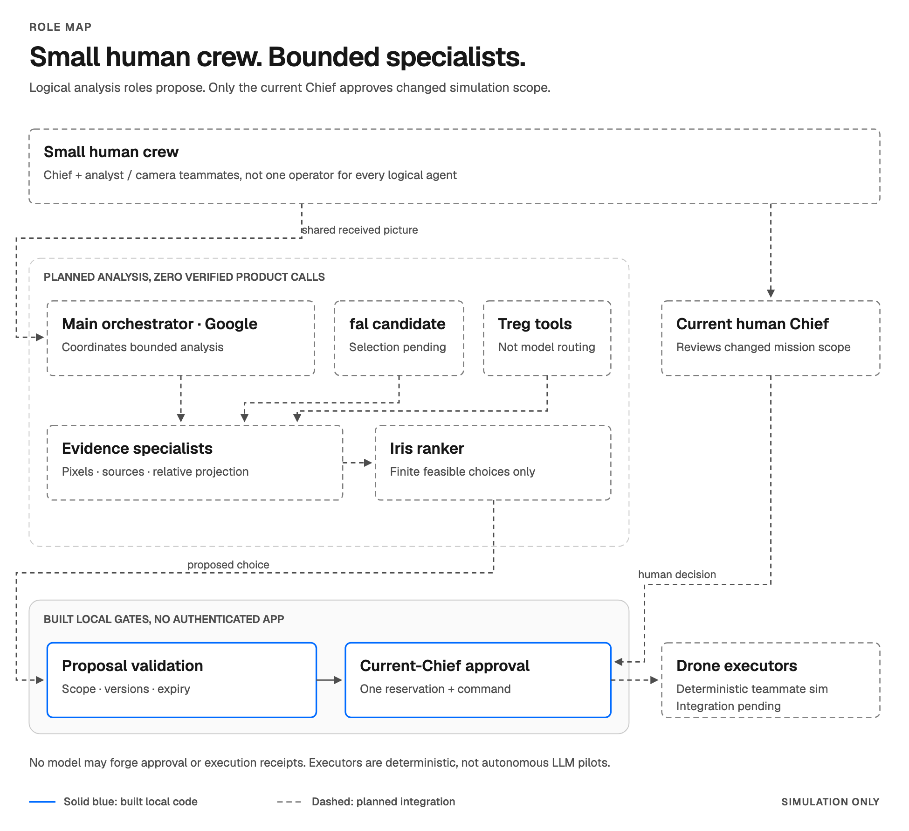

# Fire Command Center

**EXERCISE prototype, not an emergency service.** Explore a local wildfire simulator, inspect evidence and uncertainty, review proposed tasks and replay decisions.

Fire Command Center combines a visual console with a separate bounded backend for received state, approval and receipts. This guide is for judges and developers understanding or running the prototype. The product end-user direction remains undecided; existing views are not a final civilian/responder strategy.

Current main includes Ops/FIREYE, six simulated drones with distinct EO and thermal channels, monitoring/replay views, historical graphs and local scripted chat. Received-only Crew mode can read backend snapshots without simulator fallback. **Backend-approved command → frontend execution → factual completion remains unconnected**, pending mapping and contract work. No real warnings, drone/crew control or validated evacuation forecasts.

[Taskboard](TASKBOARD.md) · [Collaboration rules](AGENTS.md) · [Docs index](docs/README.md) · [Software status](SOFTWARE.md)

## Contents

[Concept and demo](#20-second-concept) · [Implementation status](#implementation-status) · [Agent roles](#runtime-agent-role-map) · [Architecture](#system-and-data-architecture) · [Approval lifecycle](#approval-and-mission-lifecycle)

[Evidence and cameras](#evidence-inputs-and-source-age) · [Software and sponsors](#software-and-sponsor-roles) · [Local setup](#run-local-protocol-checks) · [Public API](#public-protocol-and-state-api) · [Repository map](#repository-map)

[Collaboration](#contributing-and-file-ownership) · [Tests and failure modes](#verification-and-failure-modes) · [Roadmap](#roadmap-and-current-gates) · [Sources](#sources-and-attribution) · [Limits](#limitations-security-and-privacy) · [FAQ](#faq)

## 20-second concept

“Inspect an exercise scene, review a finite proposed task, approve it as the human Chief, then inspect what was actually received.” The local simulation and backend protocol demonstrate separate parts of that story, not one complete execution loop.


Read infographic paths as **solid = implemented local/fixture path**, **dashed = pending connection or dormant adapter**, never field execution or genuine provider use. The scenario is illustrative, not end-to-end acceptance. [Vector image](docs/assets/readme/demo-flow.svg) · [Mermaid source](docs/assets/readme/demo-flow.mmd) · [Editable scene](docs/assets/readme/demo-flow.excalidraw).

| Story step | What the audience should see | Current boundary |
|---|---|---|
| 1. Inspect | Identified local EO/thermal channel, source mode and uncertainty. | Simulated renders/archive context, not verified live CCTV or sensors. Backend media ingestion remains deferred. |
| 2. Analyze | Unverified evidence-linked hypotheses or finite options. | Scripted local results and bounded fixture jobs exist; genuine model inference is not verified. |
| 3. Review | Current human decision and visible rejection. | Local planner approval/task movement is separate from backend revision-bound approval. Backend `--demo` reviews one registered single-drone fixture course. |
| 4. Track and replay | Separate receipt stages and historical knowledge cutoff. | Local replay and backend receipt history exist. Crew reads received facts, but backend commands do not yet drive frontend execution/completion. |

The visual exercise uses the Mati historical reconstruction, with Caldor available in legacy replay. Monitoring adds dated source context, not an operational warning service. See the [actual route selector](proposal/fcc/src/console/entry.ts), [FIREYE guide](proposal/fcc/docs/FIREYE.md) and [monitoring limitations](proposal/fcc/docs/MONITORING.md). Final fidelity, recording and product acceptance remain gated.

## Implementation status

Source inventory snapshot: 2026-11-15, main `c98415b`. Later [bounded desktop recording checks](SUBMISSION_EVIDENCE.md#bounded-desktop-recording-checks) identify their own source baselines. **Local** means implemented exercise code, **Fixture/dormant** means bounded synthetic or disabled integration, **Pending** means not connected or accepted. None means operational readiness. Older [backend receipts](TASKBOARD.md#current-main-backend-summary), isolated builds and draft PR #2 descriptions are historical, not the current application inventory.

| Area | Status | What exists / what does not |
|---|---|---|
| Visual console/simulator | Local | Ops/FIREYE, six drones with distinct EO+thermal channels, local planner/task movement, monitoring and replay. Views are simulated/local renders or archive context. |
| Received-only Crew | Local/fixture | [Crew entry](proposal/fcc/src/console/crew/CrewApp.tsx) reads backend received state, no simulator fallback. Coordinate/feed/clock mapping and full producer acceptance remain pending. |
| Historical graph and chat | Local | Frozen EEA/CATDAT Greece series and shared Chief/Scout chat. Replies are scripted, not verified LLM inference; mascot Chief is not human approval authority. |
| Protocol, received state and bridge | Local/fixture | Closed validators, immutable reducer, loopback HTTP, revision/currentness/authority guards and producer-loss freeze. No production identity, Convex or cloud persistence. |
| Approval, receipts and replay | Local/fixture | Human-context gates, reservation, immutable command and supplied receipt progression, canonical replay. Frontend execution/completion bridge remains unconnected. |
| Planner and orchestration demo | Local/fixture | Finite toy planner supports up to three-drone courses; `--demo` registers exactly one single-drone fixture course. Neither is the six-drone frontend fleet. Changed/unregistered courses stay review-only. |
| Provider/source/compute adapters | Fixture/dormant | Bounded server-side Iris/Gemini/Gemma/fal/Treg/Firecrawl/Boxd seams and explicit source/weather packets, disabled or fixture-only by default. No genuine inference/retrieval/remote execution established. |
| Verification | Source-bound local/unit evidence | [Frontend checks](proposal/fcc/package.json) cover local simulation, channel registration, capture metadata and spread regression. Later local recording checks accepted 14 distinct camera paths and 20 actual AETOS-2 IR frame downloads. Further per-drone export coverage, ten-minute browser and complete mobile acceptance remain open. |
| Cloud, media and deployment | Pending | Real auth, Convex/persistence, media rights/ingestion and public deployment remain deferred. No operational or final submission acceptance. |

The [bounded protocol spec](docs/superpowers/specs/2026-11-14-backend-protocol-design.md) and [four-task plan](docs/superpowers/plans/2026-11-14-backend-protocol.md) authorized the historical first slice. Later exact-file claims authorized bounded additions, not full V1 or public launch. All 15 issue cards remain open at this snapshot. Administrative work and passing local tests are not full-product acceptance.

## Runtime agent role map

“Agent team” describes logical exercise responsibilities, not running VMs or already connected models. The **human Chief** is the approving person; the **Chief mascot/assistant** and Scout chat are local scripted presentation. Chat does not grant authority. High-risk proposed placements require current human approval.



Solid paths denote local/fixture responsibilities; dashed model/tool paths remain dormant or pending, not LLM receipts. [Vector image](docs/assets/readme/agent-roles.svg) · [Mermaid source](docs/assets/readme/agent-roles.mmd) · [Editable scene](docs/assets/readme/agent-roles.excalidraw).

| Role | Intended responsibility | Allowed output / authority |
|---|---|---|
| Human Chief and crew | Review evidence, choose current finite scope, inspect progress and uncertainty. | Chief approves; person's pin/preset/replay selection should remain local, not change peers. Real sessions still absent. |
| Chief/Scout assistant chat | Explain local exercise state through scripted replies. | No verified LLM call, approval privilege or field command. See [shared chat](proposal/fcc/src/console/ops/OpsComms.tsx) and [local reply implementation](proposal/fcc/src/console/ops/opsStore.ts). |
| Google orchestrator | Organize received evidence and bounded analytical tasks. | Validated hypotheses/proposals, not simulator truth, reservations or fabricated human decisions. |
| Oumi Iris decision role | Rank finite feasible choices or eligible feed IDs using current snapshots/capabilities. | Select/rank known candidates, not invent routes/resources or change calibration. Genuine call pending. |
| fal / Google visual analyst | Inspect permitted EO/thermal pixels for candidate people, animals, fire or objects. | Unverified evidence-linked hypotheses. Provider/task/thermal capability must be tested, not assumed. |
| Firecrawl / Treg source tools | Retrieve authorized articles/source material for context. | Source snapshots with attribution/times. Retrieved text has no instruction authority; Treg is a tool registry, not model routing. |
| Drone/task context and simulator | Present local simulated tasks and observations. | Teammate owns simulator truth/render/execution. Backend command-to-executor mapping remains unconnected, despite the working received-only reader. |
| Deterministic protocol/state core | Reject invalid/stale input, preserve received state, bind approval and reconstruct history. | Pure local functions. No inference, physical safety calculation, transport or cloud allocation. |

Backend analysts/coordinator consume immutable received snapshots, not animation frames or hidden future-world arrays. [Sponsor jobs](docs/contracts/sponsor-jobs.v1.md) implement bounded scheduling, including 2 physical in-flight and 8 queued jobs. Broader [crew contract](docs/contracts/crew-agent-boundaries.md) limits remain draft; do not conflate them with measured application performance or live-provider acceptance.

## System and data architecture

Two worlds must stay separate: **simulation truth** (teammate's producer) and **crew knowledge** (validated events actually received). A camera footprint or future arrival in the simulator is not evidence that crew observed a target. Models must never receive hidden planted answers.


Solid connections are local/fixture paths, including backend received state → Crew reader. Dashed connections are pending/dormant: external providers, Convex and backend command → frontend executor → completion. See [backend bridge](docs/contracts/backend-bridge.v1.md) and [callable demo](docs/demo/backend-service.md). [Vector image](docs/assets/readme/system-overview.svg) · [Mermaid source](docs/assets/readme/system-overview.mmd) · [Editable scene](docs/assets/readme/system-overview.excalidraw).

1. Local bridge derives fixture actor/run/lease context; source/weather seams validate explicit packets. Actual cameras, media ingestion, verified human identity and genuine source retrieval remain absent.
2. Closed validators accept exact versioned JSON shapes. Body-supplied role/session fields cannot grant Chief authority.
3. `commitEvent` returns a new canonical state/log with one revision advance; duplicates do not advance it. Acquisition clocks remain in payloads; receipt/actor/revision metadata comes from context.
4. Analysts propose only registered current finite candidates. `approveProposal` binds Chief, proposal/input/plan/reservation revisions and expiry, returning reservation plus enqueued command in one local transition.
5. Backend fixtures supply separate receipt stages. Acceptance validation is an intent gate, not an executor, acknowledgement or completion generator. Frontend planner approval/movement does not prove a backend command executed.
6. `replayLog` validates stored canonical history; `selectReceivedSnapshot` exposes the prefix at a UTC receipt cutoff without seed/control fields. The [Crew transport](proposal/fcc/src/console/bus/crew-transport.ts) consumes received DTOs, not simulator fallback. Integrated dual-cursor replay acceptance remains pending.

Convex's historical eventual-authority direction is currently deferred. One designated teammate producer retains simulation/capture/execution, not one independent authoritative world per browser. Local compare-and-commit models the boundary; it does **not** prove Convex distributed transaction safety or decide a replacement. Host loss requires freeze and explicit reconciled takeover, not automatic second-producer startup.

## Approval and mission lifecycle

Evidence becomes an **unverified hypothesis**, then a **finite proposal**, never a direct field order. Current trusted human Chief approval is required for new collection scope, reassignment or revised simulated ground placement. Routine observations may later run inside an already approved scope/lease; approval per frame is not the intended workflow.


The backend validates/records supplied transitions; it does not drive the frontend executor. Solid paths describe local protocol/fixture behavior; dashed executor links remain pending. A completed label in a local scenario is not a backend command completion receipt. [Vector image](docs/assets/readme/mission-lifecycle.svg) · [Mermaid source](docs/assets/readme/mission-lifecycle.mmd) · [Editable scene](docs/assets/readme/mission-lifecycle.excalidraw).

| Stage | Exact meaning |
|---|---|
| Proposed | Known candidates plus rationale/current revisions, not a command. |
| Approved | Trusted current human decision recorded with reservation; not a network send. |
| Enqueued | Generated command exists, initially `sent_sim_tick=null`; no dispatcher in this package. |
| Sent | Received producer receipt says transmission was sent. Delivery remains unconfirmed. |
| Delivered | Arrived at simulated executor. Executor may still reject. |
| Accepted | Executor accepted a valid current command. Work is not completed. |
| Running | Received progress fact, not predicted success. |
| Completed | Matching terminal receipt with linked evidence. Failed/cancelled/rejected are separate outcomes. |

Local guards bind incident/run, authority/capture epochs, command/mission versions, current Chief and relevant revisions/expiry. Same-ID conflicting reuse rejects; exact authorized duplicates return current unchanged state. Old approval cannot silently revive after reconnect. A delayed older ACK cannot regress a terminal command.

`ActorContext` is a trusted function argument, not wire privilege. Tests construct it explicitly; no real authentication implementation exists. `mode: 'live'` means local control context, **not** real cameras, a model call or a production deployment. Replay/offline contexts cannot approve new work.

## Evidence inputs and source age

| Input type | Intended use | Preserve / do not infer |
|---|---|---|
| News/articles | Context and leads worth corroborating. | Publisher/URL, post and retrieval times, quoted claims; article is not confirmed incident truth. |
| Satellite imagery/event catalog | Regional context, dated fire/terrain layers. | Layer/date/resolution/CRS/rights. Coarse imagery cannot identify individuals; approximate event geometry is not a perimeter. |
| Authorized fixed cameras | Visible scene changes, smoke or contextual evidence. | Source permission, modality, acquisition time/geometry and uncertainty. Public reachability is not reuse permission. |
| Drone EO/thermal frames | Candidate observations during simulation or permission-cleared recorded fixtures. | Unique feed/modality, source/synthetic/radiometric/calibration flags, media reference/content hash. No guessed pin or Celsius. |
| Weather/terrain/fuel proxies | Relative toy projections and exercise constraints. | Units/source epoch/geography/assumptions; reanalysis is not an as-issued forecast, paths not validated safe routes. |
| Telemetry and receipts | Last-known observed state and factual simulated progress. | Producer/epoch, command/mission/version, capture and receipt clocks. Missing receipt stays unconfirmed. |
| Model output | Candidate interpretation or finite ranking. | Actual model/task/input version, evidence links, score scale, contradictions and misses. No calibrated probability implied. |

Before new media ingestion: record source/publisher/version or commit, exact rights/license/notices, permitted use, capture/publication/retrieval/receipt clocks, geography/CRS/uncertainty and modality/resolution. Current frame schema covers a subset; broader rights manifests and backend media ingestion remain deferred. The [resource catalog](docs/data/camera-satellite-resources.md) lists candidates, not verified live feeds; existing historical assets have separate [Mati](proposal/fcc/public/data/mati/README.md), [Caldor](proposal/fcc/public/data/caldor/README.md) and [monitoring](proposal/fcc/public/data/monitoring/README.md) source notes.

### Camera and thermal rules

The local simulator has **six drones, each with distinct EO and thermal channels**. [Channel/capture tests](proposal/fcc/tests/thermal.ts) exercise registration and metadata; [rendering code](proposal/fcc/src/console/stage3d/thermal.ts) supplies local thermal presentation. These are simulated/local renders or archive context, not verified real CCTV/live sensors. Passing unit checks is not proof of 20 actual rendered exports or ten-minute browser acceptance; both remain **NOT PROVED** pending exact receipt review.

Simulated feeds require `source_kind='simulated'`, `synthetic=true`, `radiometric=false`, `calibration=null`. False-color is display, not calibrated thermal sensing or Celsius. Current protocol has no temperature fields. Real radiometric use would need source-linked calibration, permitted measurements and capability validation. Thermal does not see through walls; smoke/occlusion performance is source-specific.

Unknown source time stays `captured_at=null` with `capture_time_status='unknown'`; unknown position stays null, not `(0,0)` or a made-up GPS pin. Frame `source_position` describes capture geometry, not target geography. Hypothesis `geography` and uncertainty also remain null when unknown. A seed's declared feasible route is not calculated flight safety.

Acquisition and receipt clocks are different. Late arrival does not make old evidence fresh; replay preserves original clocks. Local [frame status logic](proposal/fcc/src/console/world/frame-capture.ts) covers stale/future/disconnected frames; this is not real clock authentication or complete browser fault acceptance. Broader [thermal contract](docs/contracts/thermal-camera.md) criteria remain gated. Aging, fading, muting or acknowledging never silently resolves an unresolved critical hypothesis.

### Historical Greece graph

The [frozen EEA/CATDAT series](proposal/fcc/src/console/data/greece-wildfire-fatalities.json) contains **45 annual records, 1980–2024, total 245 recorded fatalities**. These are supplied historical source values, not a new calculation or forecast. The [existing test](proposal/fcc/tests/wildfire-fatalities.ts) locks source bytes, metadata and chart output. Original sources: [EEA page](https://climate-adapt.eea.europa.eu/en/observatory/topics/health-impacts/wildfires) and [source-view CSV](https://tableau-public.discomap.eea.europa.eu/views/Fatalitiesassociatedwithwildfire/Fatalitiesfromwildfire.csv).

Coverage is not a complete estimate of smoke-attributable mortality. Source-vintage counts may differ from later event revisions; zeros mean none recorded in this series, not proven absence. No lives-saved, “without software,” evacuation-success or real warned/moved-person claim follows from this graph.

### Model result versus fixture result

| Provenance | Honest label |
|---|---|
| Deterministic test/scene fixture | Synthetic exercise input or scripted result, not actual inference. |
| Recorded provider reply | Replay of a particular original reply, not a new live call. No such product receipt established yet. |
| Genuine authorized future inference | Actual provider/model/task/input and latency/trace, including invalid replies and misses. |

Synthetic exercise media must be visibly labelled for viewers; planted labels/answer boxes/true coordinates stay evaluator-only and hidden from model inputs. Preserve actual model output, including misses, rather than replacing it with planted truth. Dataset ground-truth labels are not inference output or georegistration.

## Software and sponsor roles

Role selection is intended product design, not proof of using every sponsor. [SOFTWARE.md](SOFTWARE.md) links official documentation and separates local authentication, owner reports and actual integration. Paid calls default disabled pending exact scope/budget approval.

| Component | Intended role | Verified/reported state |
|---|---|---|
| TypeScript / Node | Bounded local backend and development typechecking. | Backend requires Node ≥24; pinned TypeScript 5.9.3 / `@types/node` 24.10.1 are dev-only, zero backend runtime dependencies. |
| Vite / React / Cesium / Three | 3D console, camera previews and simulator presentation. | Merged under `proposal/fcc/`, Vite 5/React 18/Tailwind 3/strict TS; separate frontend package/lock. |
| Convex | Historical eventual shared-state direction. | Currently deferred, SDK/provisioning/integration absent. |
| Google / Gemini / Gemma | Candidate analysis and finite ranking. | Gemini catalog authentication was checked, not inference. Clients/queues are dormant/fixture-only; Gemma runtime/model requirements remain unresolved. |
| Oumi / Iris | Finite decision/ranking model. | Existing organization/project verified; key setup and genuine inference pending. Account presence is not API acceptance. |
| fal | Candidate vision/video/segmentation analysis; optional generated exercise media deferred. | Credits ready per owner report, API/thermal-task capability unverified. Catalog schemas do not prove accuracy. |
| Firecrawl | Candidate news/article retrieval. | Dormant schema/context seam; native route unsupported. Prior CLI auth/quota check is not current validity or product retrieval. |
| Treg | Tool registry and source retrieval, complementary to article tools. | Configuration blocked; dormant seam and prior scoped auth are not genuine retrieval. Not a general model gateway or current validity claim. |
| Boxd | Optional bounded CPU preprocessing after approval. | Dormant jobs, remote execution unsupported. Prior auth/existing hibernated VM receipt is not wake/provision/remote-execution permission. |
| Camera/satellite tooling | Recorded/context assets and possible future permitted inputs. | Local/archive presentation and source research are not live-camera verification. Transport code licenses do not license media. |

See [provider setup](docs/architecture/provider-setup.md), [Gemma setup](docs/architecture/gemma4-setup.md) and [dry preflight](docs/architecture/provider-activation.md) for bounded server-side seams. No genuine Iris/Gemini/Gemma/fal/Treg/Firecrawl/Boxd use is established by code, fixtures, authentication or credits. Provider/media activation requires separate permission, exact task/rights/runtime and enforceable budget.

## Run local protocol checks

Use npm and Node ≥24 for the backend. Commands below describe local development, not permission for provider activation, public hosting or deployment.

### Visual exercise

From repository root:

```sh
cd proposal/fcc
npm ci --ignore-scripts
npm run dev
```

Open `http://localhost:5173/console.html` (Ops). Explicit routes, as selected by [entry.ts](proposal/fcc/src/console/entry.ts):

| Route | Local view |
|---|---|
| `/console.html?mode=fireye` | FIREYE simulated incident console. |
| `/console.html?mode=crew` | Received-only backend reader, no simulator fallback. |
| `/console.html?mode=monitoring` | Source-labelled monitoring/context, not an emergency warning service. |
| `/console.html?mode=replay` | Legacy historical reconstruction with simulated units/events. |

Map tokens are optional for local terrain/cached imagery. This quickstart does not enable image-lab submissions, source refreshes or provider calls. Existing [frontend setup](proposal/fcc/docs/SETUP.md) and [FIREYE guide](proposal/fcc/docs/FIREYE.md) contain older default-route descriptions; use the current selector above. External map/source access and media use remain subject to permissions.

Frontend check commands from `proposal/fcc/` are `npm test`, `npm run test:spread-precision`, `npm run typecheck` and `npm run build`, defined in its [package scripts](proposal/fcc/package.json). They are not end-to-end backend execution or live-provider proof.

### Backend checks and fixture service

From repository root:

```sh
cd backend
npm ci --ignore-scripts
npm test
npm run typecheck
```

[Package scripts](backend/package.json) use native `node --test tests/*.test.ts` and `tsc --noEmit`. Install restores pinned dev tooling from [lockfile](backend/package-lock.json); tests/typecheck need no provider key, VM or cloud database. Tests open and close local fixture listeners/children only. Historical test totals are not fresh results for this snapshot; see [verification boundaries](#verification-and-failure-modes).

From repository root, full pinned native/compiled verification and dry provider status:

```sh
node backend/scripts/check-backend.mjs
node backend/scripts/provider-preflight.ts --status
```

Backend-only service: `node backend/scripts/start-local.ts` starts the bridge; `node backend/scripts/start-local.ts --demo` starts callable seeded-fixture orchestration. Neither starts a browser, frontend or provider. See [local launcher](docs/demo/local-backend.md) and [demo runbook](docs/demo/backend-service.md) for exact loopback/role/expiry boundaries. Demo has one registered single-drone course, no fabricated heartbeat/completion, and freezes after >5 seconds without a real producer heartbeat.

For Crew, use the backend's actual loopback URL and incident ID (`exercise-local` for this launcher), plus **reader capability only** from its private local handoff. Keep it in memory, never URL/storage/logs; never supply Chief/producer capability. Default allowed Origin is `http://localhost:5173`. Missing media/coordinate mapping remains unavailable, not simulated fallback. This reader connection does not connect the frontend executor. Node <24/non-erasable syntax remain outside the backend contract.

## Public protocol and state API

Wire version: `backend-protocol.v1`, readonly snake_case JSON records. [Protocol exports](backend/protocol/index.ts) expose three validators; [state exports](backend/state/index.ts) expose six functions. Both re-export public [types](backend/protocol/types.ts). These are local TypeScript functions. The separately composed [HTTP bridge](docs/contracts/backend-bridge.v1.md) does not change these nine core signatures.

<details>
<summary>All nine exact public function signatures</summary>

```typescript
validateSeed(input: unknown): Result<IncidentSeed>;
validateEvent(input: unknown): Result<EventInput>;
validateApproval(input: unknown): Result<ApprovalRequest>;
createIncidentState(seed: IncidentSeed): IncidentState;
commitEvent(state: IncidentState, input: unknown, context: CommitContext): Result<IncidentState>;
approveProposal(state: IncidentState, input: unknown, context: CommitContext): Result<IncidentState>;
validateCommandAcceptance(state: IncidentState, command: Command, context: CommitContext): Result<Command>;
replayLog(seed: IncidentSeed, log: readonly CommittedEvent[]): Result<IncidentState>;
selectReceivedSnapshot(state: IncidentState, received_at: string): Result<ReceivedSnapshot>;
```

Signature reference, not a standalone executable code block. Validators return owned accepted values or rejection. `createIncidentState` throws `TypeError` for invalid seed; other listed APIs return `Result<T>` with `ok`, then `value` or `code`/`reason`. Rejection leaves caller state unchanged. Invalid closed JSON includes unknown/prototype keys, accessors, cycles, functions and non-finite numbers. Schema validity proves neither source authenticity nor media bytes.

Rejection codes: `INVALID_SCHEMA`, `INVALID_TIME`, `VERSION_MISMATCH`, `UNAUTHORIZED`, `STALE_VERSION`, `STREAM_GAP`, `CONFLICT`, `EXPIRED`, `FROZEN`. Full record/ordering semantics: [bounded spec](docs/superpowers/specs/2026-11-14-backend-protocol-design.md#exact-boundary-records).

</details>

| Record / function group | Integration contract |
|---|---|
| `IncidentSeed` | Identity/zero initial revisions, current Chief/producer epochs, assets/feeds and finite declared candidates. No hidden world is exposed by a received snapshot. |
| `EventInput` | Envelope plus `telemetry.received`, `frame.received`, `hypothesis.received`, `proposal.created`, `command.receipt`, `authority.changed` or `chief.changed`. |
| `CommitContext` | Trusted actor, actual `recorded_at`/`received_at`, `sim_tick`, control mode. Body cannot supply canonical actor/session/revision metadata. |
| `IncidentState` | Immutable seed/identity/revisions, stream cursors and canonical log. Telemetry/frame/hypothesis/proposal maps retain committed wrappers; reservation/command maps hold typed records. |
| Approval | Exact current request creates one canonical `approval.committed` containing request/command/reservation. That kind is not accepted inbound `EventInput`. |
| Acceptance | Rechecks current committed command/producer/versions/expiry; returns command, creates no receipt or movement. |
| Replay / snapshot | Validates full log, including suffix, before success. Snapshot includes identity/revision/telemetry/frames/hypotheses/commands/cutoff, not seed/candidates/control state. |

<details>
<summary>Complete synthetic telemetry envelope and fixture-based public API example</summary>

```json
{
  "contract_version": "backend-protocol.v1", "incident_id": "i1", "run_id": "r1", "authority_epoch": 1,
  "event_id": "telemetry1", "stream_id": "telemetry:d1", "stream_sequence": 1,
  "trace_id": "trace-telemetry1", "causation_id": null, "kind": "telemetry.received",
  "payload": {
    "asset_id": "d1", "mission_id": null, "mission_version": 0,
    "captured_at": "2026-11-14T00:00:01Z", "capture_time_status": "known", "sim_tick": 1,
    "position": { "x_m": 100, "y_m": 200, "z_m": 300 }, "battery_percent": 90,
    "producer_id": "sim1", "capture_epoch": 1
  }
}
```

Fixture coordinates/battery are synthetic, not a real drone observation. From a TypeScript module under `backend/`, public exports can be exercised with existing [test fixtures](backend/tests/fixtures.ts):

```typescript
import { createIncidentState, commitEvent, selectReceivedSnapshot } from './state/index.ts';
import { seed, telemetry, context } from './tests/fixtures.ts';

const initial = createIncidentState(seed());
const committed = commitEvent(initial, telemetry(), context());
if (!committed.ok) throw new Error(`${committed.code}: ${committed.reason}`);
const snapshot = selectReceivedSnapshot(committed.value, '2026-11-14T00:00:01Z');
if (!snapshot.ok) throw new Error(`${snapshot.code}: ${snapshot.reason}`);
// snapshot.value.telemetry.d1.payload is observed synthetic data at this receipt cutoff.
```

`seed`, `telemetry` and `context` are test helpers, not public package APIs or authentication. Frame `media_ref` is an opaque ID (for example `media1`), not a URL fetch sink; valid metadata/hash strings do not prove media existence, decoding or content-hash verification. See [validation](backend/protocol/validation.ts), [reducer](backend/state/reducer.ts), [approval](backend/state/approval.ts) and [replay](backend/state/replay.ts).

</details>

## Repository map

```text
fire-command-center/
├── README.md / TASKBOARD.md / AGENTS.md / SOFTWARE.md
├── backend/
│   ├── protocol/       types.ts, validation.ts, index.ts
│   ├── state/          reducer.ts, approval.ts, replay.ts, index.ts
│   ├── integration/    loopback authority, HTTP bridge, received-view DTO
│   ├── planning/       deterministic toy mission candidates
│   ├── orchestration/  bounded coordinator
│   ├── demo/           callable seeded-fixture service/scenario
│   ├── integrations/   dormant clients, queue and provenance receipts
│   ├── setup/          provider config and dry activation status
│   ├── sources/        source/context and explicit weather packets
│   ├── sandbox/        dormant finite jobs, unsupported remote execution
│   ├── scripts/        local launcher, checker, smoke and dry preflight
│   ├── tests/          native/compiled fixture and loopback tests
│   └── package.json / package-lock.json / tsconfig.json
├── proposal/fcc/       merged visual exercise, separate frontend package/lock
│   ├── src/console/    Ops/FIREYE, Crew reader, monitoring, replay, graphs/chat
│   ├── public/data/    historical/context packs with source notes
│   └── tests/          local simulation, thermal, crew and display checks
└── docs/
    ├── assets/readme/  four code-native infographic families
    ├── contracts/      reviewed backend seams and thermal/crew drafts
    ├── architecture/   backend proofs and dormant provider/compute setup
    ├── data/           camera/satellite catalog and source/context seam
    ├── demo/           backend-only launcher/service runbooks
    ├── verification/   composition/CI and producer lifecycle receipts
    ├── references/     preserved operational-clarity archive/index
    ├── specs/          simulator parameter draft
    └── superpowers/    approved protocol spec and historical test-first plan
```

`proposal/fcc/` is present on current main; its path name does not mean it is still an unmerged proposal. Teammate ownership remains unchanged. Generated dependencies/output and private `.scratch/` are ignored, not product source. The [docs index](docs/README.md) includes approved protocol, drafts and historical references; source/date labels matter when reading older status prose.

## Contributing and file ownership

Read [AGENTS.md](AGENTS.md) and [TASKBOARD.md](TASKBOARD.md) first. Claim task, branch and exact files before edits; one active owner per file. Nontrivial implementation needs named numeric tests before plan, explicit non-goals, approved scope and independent review. Full V1 permission does not follow automatically from local protocol approval.

| Lane | Ownership |
|---|---|
| Design/simulator/frontend | Teammate owns all `proposal/fcc/**`, world/runtime/store/adapters/render/camera assets and frontend package/lock. Root never edits that source. |
| Architecture/data/backend/agents | Coordinator/root owns approved backend seams and versioned root contracts/data documents. Future paths require exact claims, not wildcard permission. |
| Shared schemas/locks/CI | One designated owner per shared file. Interface changes go through reviewed contract revision and all consumers, not silent cross-owner edits. |
| Delivery | Coding/document workers do not stage/push/merge/deploy. Authorized Git coordinator delivers explicit reviewed paths on branch/PR. |

Use separate task branches/worktrees; preserve other workers' changes. Do not rewrite simulator truth to fix an evidence discrepancy. Person-local pins/presets/replay cursors should remain outside shared incident revisions. An unused socket adapter, screenshot or green build is not a shared-state integration receipt.

## Verification and failure modes

Backend tests call actual native/compiled exports with fixtures, including loopback HTTP and CLI composition. They test bounded local consistency/lifecycle rules, not field observations, source permissions, real authentication or Convex atomicity. [Earlier backend receipts](TASKBOARD.md#current-main-backend-summary) retain their original source/date. The table below describes the historical first protocol slice, not a current suite total.

| Suite | Count | Exercised locally |
|---|---:|---|
| [Validation](backend/tests/validation.test.ts) | 19 | Closed records, real calendar UTC, malformed values, declared thermal metadata and unknown fields. |
| [Reducer](backend/tests/reducer.test.ts) | 23 | Immutable ordering, duplicates/conflicts, actor/producer boundaries, received state and explicit freeze/takeover. |
| [Approval](backend/tests/approval.test.ts) | 18 | Current human-context/revision binding, local serialized races, reservation/TTL/lease and command acceptance. |
| [Replay](backend/tests/replay.test.ts) | 11 | Canonical reconstruction/cutoffs, receipt progression, corruption rejection and preserved critical hypotheses. |

Frontend checks (`npm test`, `npm run test:spread-precision`, `npm run typecheck`, `npm run build`) cover local simulation, channel registration, capture metadata and spread regression. Fake-canvas unit captures are not rendered camera exports. **20 actual rendered exports and ten-minute browser acceptance remain NOT PROVED** for this source snapshot.

Historical CI note: PR #48's Node 24 `BODY01` failure was a client-lease versus server-close timing assertion mismatch, not current CI status. Consult [current PR #48 checks](https://github.com/nikolas-sapa/fire-command-center/pull/48/checks) for later-source results. This README remains pinned to `c98415b`.

Still unproved: backend-to-frontend execution/completion mapping, full loss/retry/rejoin, Convex races, production identity, real thermal measurement/detection, browser accessibility/performance, calibrated route/energy physics, genuine provider calls and deployment.

| Failure | Core behavior / remaining integration duty |
|---|---|
| Wrong run/epoch/revision or malformed model-shaped result | Reject stale/invalid input, no mutation. Dormant adapter validation exists; genuine provider acceptance absent. |
| Exact duplicate / conflicting reused ID | Authorized exact duplicate leaves current state unchanged; changed reuse rejects. HTTP retry fixtures exist, full teammate link fault model unverified. |
| Stream gap | Core rejects `STREAM_GAP`; bridge commits explicit freeze for semantically valid producer gaps. Malformed/foreign payloads do not freeze. Reconcile before further execution. |
| Producer loss or Chief handoff | Explicit loss freezes; server takeover advances epochs; old intent blocked while executor history remains. No automatic host election. |
| Late frame or ACK | Preserve history without replacing newer last-known facts or regressing terminal status. Local frame status exists; full browser fault acceptance remains pending. |
| Corrupt replay suffix | Reject complete log, not partial success. No replay-time calls/dispatch. |
| Provider outage / missing calibration / missing receipt | Bounded jobs/deterministic fallback exist; unknown temperature remains unknown, absent progress unconfirmed. Genuine providers and full exercise fault model unverified. |

## Roadmap and current gates

1. Review current-source receipts and outstanding issue cards. Keep the end-user/interface direction pending owner decision.
2. Approve explicit producer/coordinate/feed/clock/command mapping, then connect backend-approved commands to frontend execution and factual receipts. Do not replace the received-only reader with simulator fallback.
3. Review 20 actual rendered exports and ten-minute browser acceptance, including source labels, uncertainty, human approval, loss/rejoin and replay. Existing channels alone do not close these gates.
4. Resolve provider model/runtime/configuration, rights and budget gates before any genuine inference/retrieval. Cloud/auth/persistence and media integration need separate approval.
5. Freeze reviewed evidence and attribution before separately authorizing any public deployment or submission.

All 15 issue cards remain open at this snapshot. The [historical build cards](TASKBOARD.md#detailed-build-cards-full-acceptance-gated) and their workflow checkpoints are not readiness percentages. Published draft/admin checks are not product acceptance; this README neither closes cards nor chooses a final audience.

## Sources and attribution

[Camera/satellite catalog](docs/data/camera-satellite-resources.md) is the source of pinned candidate terms: MediaMTX MIT transport, HIT-UAV CC BY 4.0 recorded thermal fixtures, HPWREN archive/live permission distinctions, USGS public-domain volcano context, NASA GIBS/EONET dated context and optional Apache-2.0 PySTAC Client metadata helper. Each has different use limits. Catalog entries are not ingestion receipts; existing historical/context packs retain their own notices. Software license does not license imagery.

HIT-UAV labels must stay ground truth, not be passed as model answers. NASA event context is approximate/non-authoritative; 10 m satellite pixels cannot identify people. Public camera access does not grant automated retrieval, embedding or model-use rights. Preserve original source notices and changes for any later selected asset.

Prior [wildfire-sweep research](https://github.com/nikolas-sapa/wildfire-sweep/tree/66bb3c9), baseline `66bb3c9`, dated 2026-11-10, predates event work. Frozen outputs remain untouched. Any reuse requires **file-level source + commit + license + attribution**, with visible pre-existing/event-adapted/event-new split. No hidden reuse, masking or backdating. Existing [reference archive](docs/references/operational-clarity-index.md) preserves supplied historical material, not adopted product requirements.

Repository remains private and has no project-wide license grant. Broader publication/open-source licensing is not approved by this documentation task. Open-source-core monetization is a hypothesis, not a decided business model. Linked third-party licenses do not license this repository.

## Limitations, security and privacy

Prototype/synthetic relative danger indexes and paths are not validated operational forecasts or safe placements. Unverified person/object/fire appearance is not confirmed victim identity, canister contents or hazard severity. No life-saving, accuracy, ROI, staffing-percentage or customer-traction claims established.

Non-goals: real aircraft/vehicle control, emergency dispatch, field orders/public alarms, calibrated thermal measurements, validated identification/forecasting, full PX4/controller training, unlimited ingestion/autoscaling or unbounded agent autonomy. No deployment/shared application follows from local tests.

Retrieved articles, images, source metadata and model replies are untrusted data, not instructions. Provider credentials stay server-side; never commit keys, `.env`, auth/browser bundles, balances or private account details. Backend lexical media IDs have no fetch sink; backend media upload/fetch permissions, redirect validation, private-network blocking, MIME/byte decoding and retention controls remain unimplemented.

Future camera/person evidence needs explicit access rights, minimal retained data and a reviewed privacy policy. This repo performs no live person identification or camera scanning. Schema validation cannot establish media ownership, privacy compliance or physically safe actions.

## FAQ

**Can I run the visual exercise from main?** Yes, `proposal/fcc/` contains the local console/simulator. Use the [local setup](#run-local-protocol-checks). It is not a complete backend-driven execution loop, deployed service or operational product.

**Is Chief/Scout chat an LLM or approval authority?** No verified LLM call. Replies are local/scripted. The Chief mascot/assistant is distinct from the human Chief, whose current approval remains required for high-risk proposed placements.

**Which providers have genuinely run?** No genuine Iris/Gemini/Gemma/fal/Treg/Firecrawl/Boxd use is established. Gemini catalog authentication is not inference; Treg configuration is blocked and Gemma requirements remain unresolved. Fixtures and earlier auth/credit reports do not prove current access or product use.

**Are all drone feeds thermal?** Each of six local simulated drones has distinct EO and thermal channels. They are non-radiometric, not real sensors, measured temperatures or confirmed people. The one-drone backend `--demo` fixture is separate. Rendered-export/browser acceptance remains unproved.

**Does approving a backend command move a frontend drone?** Not yet. Local planner approval/movement and backend approval/immutable commands/receipts are separate slices. Crew reads backend state, but the command → execution → completion connection still needs mapping and contract work.

**What does “live” mean here?** A local control-mode/context label, not proof of real footage, model access, cloud service or current source acquisition. Always inspect source mode and original clocks.

**What happens when evidence goes stale or link disappears?** Keep last-known facts and unresolved critical hypotheses; no invented arrival/completion. Local frame status handles staleness and the backend freezes after producer absence. Full producer loss/rejoin and browser acceptance remain unverified.

**Can models approve commands or invent target pins?** No intended authority. Chief context/revisions gate approval; unknown geography stays null. Models propose finite known options and unverified evidence-linked hypotheses.

**Does the graph show lives saved, or does the app warn/move real people?** No. The graph is the frozen historical EEA/CATDAT series with vintage/coverage caveats. No real public warnings, SMS, phone calls, drone/crew control, validated evacuation routes or “without software” comparison is demonstrated.

**What should contributors do next?** Read TASKBOARD and claim an approved exact-file lane. Integration is gated; installing a SDK, using reported credits or deploying is not authorized merely by reading this guide.
