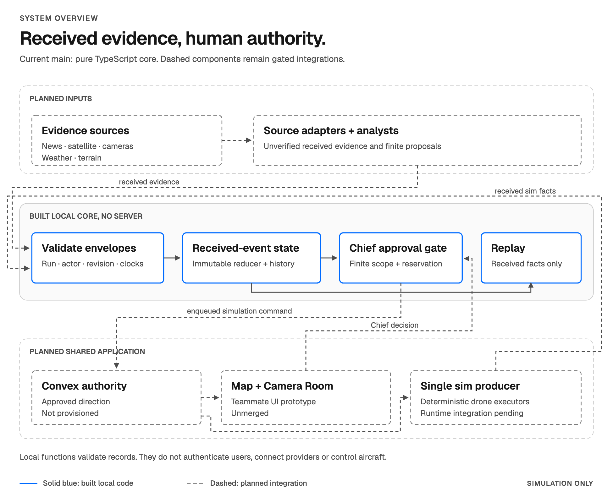

# Fire Command Center

Small human crew. Larger team of analyst and drone-agent contexts. One shared picture of what actually arrived, one accountable human approving changed mission scope.

Fire Command Center is a hackathon coordination prototype for **wildfire exercises**. Intended workflow: collect permission-cleared evidence, surface unverified hypotheses, rank finite collection or placement options, obtain Chief approval, track simulated execution, then replay the decision trail. Goal: make evidence, uncertainty and responsibility understandable to a small crew without assigning a human to every logical agent. No measured staffing benefit claimed.

Current main delivers a bounded local backend: validated received state, revision-bound approval/replay, a loopback HTTP bridge, deterministic toy planner, callable seeded-fixture orchestration demo and dormant provider/source/compute seams. Teammate's visual console remains a separate submitted prototype. No operational emergency response, live drone control or validated rescue prediction.

[Taskboard](TASKBOARD.md) · [Collaboration rules](AGENTS.md) · [Docs index](docs/README.md) · [Software status](SOFTWARE.md)

## Contents

[Concept and demo](#20-second-concept) · [Implementation status](#implementation-status) · [Agent roles](#runtime-agent-role-map) · [Architecture](#system-and-data-architecture) · [Approval lifecycle](#approval-and-mission-lifecycle)

[Evidence and cameras](#evidence-inputs-and-source-age) · [Software and sponsors](#software-and-sponsor-roles) · [Local setup](#run-local-protocol-checks) · [Public API](#public-protocol-and-state-api) · [Repository map](#repository-map)

[Collaboration](#contributing-and-file-ownership) · [Tests and failure modes](#verification-and-failure-modes) · [Roadmap](#roadmap-and-current-gates) · [Sources](#sources-and-attribution) · [Limits](#limitations-security-and-privacy) · [FAQ](#faq)

## 20-second concept

“Several camera and source feeds suggest something worth checking. Analysts explain the evidence and uncertainty. Chief approves one finite simulated task. Crew sees whether it was sent, delivered, accepted and completed, then replays exactly what was known.” This is the product concept, not a claim that every step runs today.


Proposed scan-area illustration, not a working end-to-end demonstration. Table below describes the broader evidence-to-replay product story. [Vector image](docs/assets/readme/demo-flow.svg) · [Mermaid source](docs/assets/readme/demo-flow.mmd) · [Editable scene](docs/assets/readme/demo-flow.excalidraw).

| Story step | What the audience should see | Current boundary |
|---|---|---|
| 1. Capture | Identified feed, acquisition/receipt clocks, source mode and uncertainty. | Metadata HTTP receipt bridge exists; no camera/media ingest or decoder. |
| 2. Analyze | Unverified human/animal/fire/canister hypothesis linked to evidence. | Validated jobs and deterministic fallback exist; genuine model inference absent. |
| 3. Review | Finite options and rationale, current Chief decision, visible rejection. | Callable demo reviews one registered fixture course with local role gates; real identity/UI integration absent. |
| 4. Track and replay | Separate receipt stages, last-known state during loss, historical knowledge cutoff. | Loopback bridge records supplied receipts and replay; teammate executor/frontend integration unverified. |

Proposed scenario may combine news, satellite context, weather/terrain and authorized cameras. Current PR #2 defaults to the Mati historical replay, with Caldor selectable; North Evia remains a candidate, not an adopted replacement. Proposed fleet sizes, region, fidelity and final recording length still require agreement. Do not present the concept diagram as a live-provider receipt.

## Implementation status

Snapshot: 2026-11-15, main source `0dc82518` (PR #34 at `47094cf`, PR #35 at `0dc8251`). **Built** means implemented local code, **Submitted** means separate unmerged source, **Planned** means future gated integration, **Proposed** means draft concept/contract. These labels are not readiness percentages. [Current main summary](TASKBOARD.md#current-main-backend-summary) supersedes earlier protocol-only/pending-delivery board snapshots; historical receipts retain their original source/date.

| Area | Status | What exists / what does not |
|---|---|---|
| Protocol validation | Built, main | Closed JSON guards for seed, seven event kinds and approval requests. No source authenticity guarantee. |
| Received state and bridge | Built, main | Immutable reducer plus bounded loopback HTTP service, two fixture readers, producer-loss freeze and received-only DTOs. No Convex/persistent/shared production authority. |
| Approval and receipts | Built, main | Local role-capability/Chief checks, exclusive reservation, enqueued command and supplied receipt progression. No real identity or teammate executor integration. |
| Replay | Built, main | Canonical log reconstruction and receipt-cutoff snapshots. No model calls, live commands or integrated console replay acceptance. |
| Planner and orchestration demo | Built, main | Toy planner proposes up to three-drone courses; callable `--demo` registers exactly one single-drone fixture course. Changed/unregistered courses stay review-only, no dynamic registry. |
| Local verification and CI | Built, main | 242 native and compiled tests reviewed; hosted backend Node 24/26 checks SUCCESS. Not Convex, browser, genuine-provider or field acceptance. |
| Visual console/simulator | Submitted | [Draft PR #2](https://github.com/nikolas-sapa/fire-command-center/pull/2), current `c2682d4`, unmerged. Historical isolated install/build/typecheck at `6bdb5884`; current browser/full-product acceptance unverified. |
| Shared application | Deferred | Historical Convex eventual-authority direction, one teammate simulator producer. No SDK/provisioning/Convex two-client integration, no replacement authority decision. |
| Provider setup and jobs | Built, dormant | Iris/Gemini/fal/Treg/Gemma clients, bounded queue, sanitized setup/preflight and smoke seam. Default disabled; genuine inference/retrieval 0, live hard-ceiling restrictions unchanged. |
| Source/weather and Boxd | Built, dormant | Validated source/context and explicit weather packets, unsupported Firecrawl native route, finite local sandbox jobs. No genuine retrieval/weather fetch/remote execution. |
| Thermal fleet, Camera Room, fault-aware exercise | Proposed | Draft contracts and simulator requirements. Current console's mixed EO/false-color channels do not satisfy every-drone thermal requirement. |
| Deployment and submission | Planned | No deployed service or final submission receipt established by this repository. |

The [bounded protocol spec](docs/superpowers/specs/2026-11-14-backend-protocol-design.md) and [four-task plan](docs/superpowers/plans/2026-11-14-backend-protocol.md) are historical first-slice authorization. Later exact-file claims/tests/reviews authorized the bounded backend additions above, not full V1. Frontend launch/adoption requires explicit owner confirmation; media, Convex and real application auth remain deferred. Administrative work and passing local tests do not complete any full-product P0 card.

## Runtime agent role map

“Agent team” describes logical product responsibilities, not the coding agents used to build this repo, running VMs or already connected models. A small human crew supervises bounded contexts; one current Chief controls changed collection/placement scope. No recursive spawning or unrestricted autonomous mission generation intended.


Diagram preserves the earlier protocol-only concept. Current deterministic coordinator/jobs are built; genuine model roles remain inactive, not an LLM receipt. [Vector image](docs/assets/readme/agent-roles.svg) · [Mermaid source](docs/assets/readme/agent-roles.mmd) · [Editable scene](docs/assets/readme/agent-roles.excalidraw).

| Role | Intended responsibility | Allowed output / authority |
|---|---|---|
| Human Chief and crew | Review evidence, choose current finite scope, inspect progress and uncertainty. | Chief approves; person's pin/preset/replay selection should remain local, not change peers. Real sessions still absent. |
| Google orchestrator | Organize received evidence and bounded analytical tasks. | Validated hypotheses/proposals, not simulator truth, reservations or fabricated human decisions. |
| Oumi Iris decision role | Rank finite feasible choices or eligible feed IDs using current snapshots/capabilities. | Select/rank known candidates, not invent routes/resources or change calibration. Genuine call pending. |
| fal / Google visual analyst | Inspect permitted EO/thermal pixels for candidate people, animals, fire or objects. | Unverified evidence-linked hypotheses. Provider/task/thermal capability must be tested, not assumed. |
| Firecrawl / Treg source tools | Retrieve authorized articles/source material for context. | Source snapshots with attribution/times. Retrieved text has no instruction authority; Treg is a tool registry, not model routing. |
| Drone/task context and simulator | Execute only approved finite simulated work, capture observations, emit factual receipts. | Teammate owns simulator truth/render/execution; root consumes events. Submitted console is not integrated with this core. |
| Deterministic protocol/state core | Reject invalid/stale input, preserve received state, bind approval and reconstruct history. | Pure local functions. No inference, physical safety calculation, transport or cloud allocation. |

Analysts/coordinator consume immutable received snapshots, not animation frames or hidden future-world arrays. [Sponsor jobs](docs/contracts/sponsor-jobs.v1.md) implement bounded scheduling, including 2 physical in-flight and 8 queued jobs. Broader [crew contract](docs/contracts/crew-agent-boundaries.md) limits remain draft; do not conflate them with measured application performance or live-provider acceptance.

## System and data architecture

Two worlds must stay separate: **simulation truth** (teammate's producer) and **crew knowledge** (validated events actually received). A camera footprint or future arrival in the simulator is not evidence that crew observed a target. Models must never receive hidden planted answers.



Diagram preserves the earlier protocol-only snapshot. Current loopback connections are documented in [backend bridge](docs/contracts/backend-bridge.v1.md) and [callable demo](docs/demo/backend-service.md); arrows to external providers/Convex/crew clients remain intended seams. [Vector image](docs/assets/readme/system-overview.svg) · [Mermaid source](docs/assets/readme/system-overview.mmd) · [Editable scene](docs/assets/readme/system-overview.excalidraw).

1. Local bridge derives fixture actor/run/lease context; source/weather seams validate explicit packets. Actual cameras, media ingestion, verified human identity and genuine source retrieval remain absent.
2. Closed validators accept exact versioned JSON shapes. Body-supplied role/session fields cannot grant Chief authority.
3. `commitEvent` returns a new canonical state/log with one revision advance; duplicates do not advance it. Acquisition clocks remain in payloads; receipt/actor/revision metadata comes from context.
4. Analysts propose only registered current finite candidates. `approveProposal` binds Chief, proposal/input/plan/reservation revisions and expiry, returning reservation plus enqueued command in one local transition.
5. Simulator receipts report separately received stages. Acceptance validation is an intent gate, not an executor, acknowledgement or completion generator.
6. `replayLog` validates stored canonical history; `selectReceivedSnapshot` exposes the prefix at a UTC receipt cutoff without seed/control fields. Full dual-cursor frontend replay remains future work.

Convex's historical eventual-authority direction is currently deferred. One designated teammate producer retains simulation/capture/execution, not one independent authoritative world per browser. Local compare-and-commit models the boundary; it does **not** prove Convex distributed transaction safety or decide a replacement. Host loss requires freeze and explicit reconciled takeover, not automatic second-producer startup.

## Approval and mission lifecycle

Evidence becomes an **unverified hypothesis**, then a **finite proposal**, never a direct field order. Current trusted human Chief approval is required for new collection scope, reassignment or revised simulated ground placement. Routine observations may later run inside an already approved scope/lease; approval per frame is not the intended workflow.


Built core and loopback bridge validate/record supplied transitions; teammate simulated executor integration remains unverified. Diagram is a protocol concept, not a current provider/executor receipt. [Vector image](docs/assets/readme/mission-lifecycle.svg) · [Mermaid source](docs/assets/readme/mission-lifecycle.mmd) · [Editable scene](docs/assets/readme/mission-lifecycle.excalidraw).

| Stage | Exact meaning |
|---|---|
| Proposed | Known candidates plus rationale/current revisions, not a command. |
| Approved | Trusted current human decision recorded with reservation; not a network send. |
| Enqueued | Generated command exists, initially `sent_sim_tick=null`; no dispatcher in this package. |
| Sent | Received producer receipt says transmission was sent. Delivery remains unconfirmed. |
| Delivered | Arrived at simulated executor. Executor may still reject. |
| Accepted | Executor accepted a valid current command. Work is not completed. |
| Running | Received progress fact, not predicted success. |
| Completed | Matching terminal receipt with linked evidence. Failed/cancelled/rejected are separate outcomes. |

Local guards bind incident/run, authority/capture epochs, command/mission versions, current Chief and relevant revisions/expiry. Same-ID conflicting reuse rejects; exact authorized duplicates return current unchanged state. Old approval cannot silently revive after reconnect. A delayed older ACK cannot regress a terminal command.

`ActorContext` is a trusted function argument, not wire privilege. Tests construct it explicitly; no real authentication implementation exists. `mode: 'live'` means local control context, **not** real cameras, a model call or a production deployment. Replay/offline contexts cannot approve new work.

## Evidence inputs and source age

| Input type | Intended use | Preserve / do not infer |
|---|---|---|
| News/articles | Context and leads worth corroborating. | Publisher/URL, post and retrieval times, quoted claims; article is not confirmed incident truth. |
| Satellite imagery/event catalog | Regional context, dated fire/terrain layers. | Layer/date/resolution/CRS/rights. Coarse imagery cannot identify individuals; approximate event geometry is not a perimeter. |
| Authorized fixed cameras | Visible scene changes, smoke or contextual evidence. | Source permission, modality, acquisition time/geometry and uncertainty. Public reachability is not reuse permission. |
| Drone EO/thermal frames | Candidate observations during simulation or permission-cleared recorded fixtures. | Unique feed/modality, source/synthetic/radiometric/calibration flags, media reference/content hash. No guessed pin or Celsius. |
| Weather/terrain/fuel proxies | Relative toy projections and exercise constraints. | Units/source epoch/geography/assumptions; reanalysis is not an as-issued forecast, paths not validated safe routes. |
| Telemetry and receipts | Last-known observed state and factual simulated progress. | Producer/epoch, command/mission/version, capture and receipt clocks. Missing receipt stays unconfirmed. |
| Model output | Candidate interpretation or finite ranking. | Actual model/task/input version, evidence links, score scale, contradictions and misses. No calibrated probability implied. |

Before ingest: record source/publisher/version or commit, exact rights/license/notices, permitted use, capture/publication/retrieval/receipt clocks, geography/CRS/uncertainty and modality/resolution. Current frame schema covers a subset; full rights manifests and ingest jobs are future work. [Pinned resource catalog](docs/data/camera-satellite-resources.md) lists six complementary candidates, not installed sources.

### Camera and thermal rules

Every simulated drone is required to have a distinct thermal feed; optional EO is a separate channel. Core seed validators enforce declared thermal registrations, but metadata is not demonstrated rendered capability. PR #2 currently mixes EO and false-color channels, so fleet requirement is not met by that submission.

Simulated feeds require `source_kind='simulated'`, `synthetic=true`, `radiometric=false`, `calibration=null`. False-color is display, not calibrated thermal sensing or Celsius. Current protocol has no temperature fields. Real radiometric use would need source-linked calibration, permitted measurements and capability validation. Thermal does not see through walls; smoke/occlusion performance is source-specific.

Unknown source time stays `captured_at=null` with `capture_time_status='unknown'`; unknown position stays null, not `(0,0)` or a made-up GPS pin. Frame `source_position` describes capture geometry, not target geography. Hypothesis `geography` and uncertainty also remain null when unknown. A seed's declared feasible route is not calculated flight safety.

Acquisition and receipt clocks are different. Late arrival does not make old evidence fresh; replay preserves original clocks. Core stores these distinctions, but UI aging/ranking and real clock authentication are not implemented. Proposed stale thresholds in [thermal draft](docs/contracts/thermal-camera.md) remain future acceptance criteria. Aging, fading, muting or acknowledging never silently resolves an unresolved critical hypothesis.

### Model result versus fixture result

| Provenance | Honest label |
|---|---|
| Deterministic test/scene fixture | Synthetic exercise input or scripted result, not actual inference. |
| Recorded provider reply | Replay of a particular original reply, not a new live call. No such product receipt established yet. |
| Genuine authorized future inference | Actual provider/model/task/input and latency/trace, including invalid replies and misses. |

Synthetic exercise media must be visibly labelled for viewers; planted labels/answer boxes/true coordinates stay evaluator-only and hidden from model inputs. Preserve actual model output, including misses, rather than replacing it with planted truth. Dataset ground-truth labels are not inference output or georegistration.

## Software and sponsor roles

Role selection is intended product design, not proof of using every sponsor. [SOFTWARE.md](SOFTWARE.md) links official documentation and separates local authentication, owner reports and actual integration. Paid calls default disabled pending exact scope/budget approval.

| Component | Intended role | Verified/reported state |
|---|---|---|
| TypeScript / Node | Bounded local backend and development typechecking. | Main package, Node ≥24; local 26.11.1, hosted Node 24/26 SUCCESS. TypeScript 5.9.3 / `@types/node` 24.10.1 dev-only, zero runtime dependencies. |
| Vite / React / Cesium | Teammate's 3D console, camera previews and simulator presentation. | Separate draft PR #2, Vite 5/React 18/Tailwind 3/strict TS/Cesium; unmerged. Not root backend dependencies. |
| Convex | Historical eventual shared-state direction. | Currently deferred, SDK/provisioning/integration absent. |
| Google / Gemini / Gemma | Candidate analysis and finite ranking. | Dormant clients/queue; previous authenticated Gemini model catalog included Gemma. Not current validity, quota or inference proof; genuine calls 0. |
| Oumi / Iris | Finite decision/ranking model. | Existing organization/project verified; key setup and genuine inference pending. Account presence is not API acceptance. |
| fal | Candidate vision/video/segmentation analysis; optional generated exercise media deferred. | Credits ready per owner report, API/thermal-task capability unverified. Catalog schemas do not prove accuracy. |
| Firecrawl | Candidate news/article retrieval. | Dormant schema/context seam; native route unsupported. Prior CLI auth/quota check is not current validity or product retrieval. |
| Treg | Tool registry and source retrieval, complementary to article tools. | Dormant client/source seam; prior scoped auth check, genuine retrieval 0. Not a general model gateway or current validity claim. |
| Boxd | Optional bounded CPU preprocessing after approval. | Dormant jobs, remote execution unsupported. Prior auth/existing hibernated VM receipt is not wake/provision/remote-execution permission. |
| Camera/satellite tooling | Permission-cleared recorded/stream/context inputs. | Research only. Transport code licenses do not license media. |

Nonsecret [backend example](backend/.env.example), [provider setup](docs/architecture/provider-setup.md), [Gemma setup](docs/architecture/gemma4-setup.md) and [dry preflight](docs/architecture/provider-activation.md) exist. Oumi/fal credentials were missing within the previously checked scope, setup unresolved. Do not copy private account details or treat earlier account/catalog checks as fresh validity. Default activation/inference/retrieval remains 0; actual loopback fixture transports are not live-provider receipts.

## Run local protocol checks

From repo root, use Node ≥24 and npm:

```sh
cd backend
npm ci --ignore-scripts
npm test
npm run typecheck
```

Local reviewed native/compiled result: 242/242 on Node 26.11.1. Hosted backend Node 24/26 checks [SUCCESS](https://github.com/nikolas-sapa/fire-command-center/actions/runs/43674391602), coordinator-verified. [Package scripts](backend/package.json) use native `node --test tests/*.test.ts` and `tsc --noEmit`. Install restores pinned dev tooling from [lockfile](backend/package-lock.json); tests/typecheck need no provider key, VM or cloud database. Tests open and close local fixture listeners/children only.

From repository root, full pinned native/compiled verification and dry provider status:

```sh
node backend/scripts/check-backend.mjs
node backend/scripts/provider-preflight.ts --status
```

Backend-only service: `node backend/scripts/start-local.ts` starts the bridge; `node backend/scripts/start-local.ts --demo` starts callable seeded-fixture orchestration. No browser/frontend/provider starts. See [local launcher](docs/demo/local-backend.md) and [demo runbook](docs/demo/backend-service.md) for exact loopback/role/expiry boundaries. Demo has one registered single-drone course, no fabricated heartbeat/completion, and freezes after >5 seconds without a real producer heartbeat. There is no root app manifest or authorized frontend launch command. Node <24/non-erasable syntax remain outside this package's contract.

## Public protocol and state API

Wire version: `backend-protocol.v1`, readonly snake_case JSON records. [Protocol exports](backend/protocol/index.ts) expose three validators; [state exports](backend/state/index.ts) expose six functions. Both re-export public [types](backend/protocol/types.ts). These are local TypeScript functions. The separately composed [HTTP bridge](docs/contracts/backend-bridge.v1.md) does not change these nine core signatures.

<details>
<summary>All nine exact public function signatures</summary>

```typescript
validateSeed(input: unknown): Result<IncidentSeed>;
validateEvent(input: unknown): Result<EventInput>;
validateApproval(input: unknown): Result<ApprovalRequest>;
createIncidentState(seed: IncidentSeed): IncidentState;
commitEvent(state: IncidentState, input: unknown, context: CommitContext): Result<IncidentState>;
approveProposal(state: IncidentState, input: unknown, context: CommitContext): Result<IncidentState>;
validateCommandAcceptance(state: IncidentState, command: Command, context: CommitContext): Result<Command>;
replayLog(seed: IncidentSeed, log: readonly CommittedEvent[]): Result<IncidentState>;
selectReceivedSnapshot(state: IncidentState, received_at: string): Result<ReceivedSnapshot>;
```

Signature reference, not a standalone executable code block. Validators return owned accepted values or rejection. `createIncidentState` throws `TypeError` for invalid seed; other listed APIs return `Result<T>` with `ok`, then `value` or `code`/`reason`. Rejection leaves caller state unchanged. Invalid closed JSON includes unknown/prototype keys, accessors, cycles, functions and non-finite numbers. Schema validity proves neither source authenticity nor media bytes.

Rejection codes: `INVALID_SCHEMA`, `INVALID_TIME`, `VERSION_MISMATCH`, `UNAUTHORIZED`, `STALE_VERSION`, `STREAM_GAP`, `CONFLICT`, `EXPIRED`, `FROZEN`. Full record/ordering semantics: [bounded spec](docs/superpowers/specs/2026-11-14-backend-protocol-design.md#exact-boundary-records).

</details>

| Record / function group | Integration contract |
|---|---|
| `IncidentSeed` | Identity/zero initial revisions, current Chief/producer epochs, assets/feeds and finite declared candidates. No hidden world is exposed by a received snapshot. |
| `EventInput` | Envelope plus `telemetry.received`, `frame.received`, `hypothesis.received`, `proposal.created`, `command.receipt`, `authority.changed` or `chief.changed`. |
| `CommitContext` | Trusted actor, actual `recorded_at`/`received_at`, `sim_tick`, control mode. Body cannot supply canonical actor/session/revision metadata. |
| `IncidentState` | Immutable seed/identity/revisions, stream cursors and canonical log. Telemetry/frame/hypothesis/proposal maps retain committed wrappers; reservation/command maps hold typed records. |
| Approval | Exact current request creates one canonical `approval.committed` containing request/command/reservation. That kind is not accepted inbound `EventInput`. |
| Acceptance | Rechecks current committed command/producer/versions/expiry; returns command, creates no receipt or movement. |
| Replay / snapshot | Validates full log, including suffix, before success. Snapshot includes identity/revision/telemetry/frames/hypotheses/commands/cutoff, not seed/candidates/control state. |

<details>
<summary>Complete synthetic telemetry envelope and fixture-based public API example</summary>

```json
{
  "contract_version": "backend-protocol.v1", "incident_id": "i1", "run_id": "r1", "authority_epoch": 1,
  "event_id": "telemetry1", "stream_id": "telemetry:d1", "stream_sequence": 1,
  "trace_id": "trace-telemetry1", "causation_id": null, "kind": "telemetry.received",
  "payload": {
    "asset_id": "d1", "mission_id": null, "mission_version": 0,
    "captured_at": "2026-11-14T00:00:01Z", "capture_time_status": "known", "sim_tick": 1,
    "position": { "x_m": 100, "y_m": 200, "z_m": 300 }, "battery_percent": 90,
    "producer_id": "sim1", "capture_epoch": 1
  }
}
```

Fixture coordinates/battery are synthetic, not a real drone observation. From a TypeScript module under `backend/`, public exports can be exercised with existing [test fixtures](backend/tests/fixtures.ts):

```typescript
import { createIncidentState, commitEvent, selectReceivedSnapshot } from './state/index.ts';
import { seed, telemetry, context } from './tests/fixtures.ts';

const initial = createIncidentState(seed());
const committed = commitEvent(initial, telemetry(), context());
if (!committed.ok) throw new Error(`${committed.code}: ${committed.reason}`);
const snapshot = selectReceivedSnapshot(committed.value, '2026-11-14T00:00:01Z');
if (!snapshot.ok) throw new Error(`${snapshot.code}: ${snapshot.reason}`);
// snapshot.value.telemetry.d1.payload is observed synthetic data at this receipt cutoff.
```

`seed`, `telemetry` and `context` are test helpers, not public package APIs or authentication. Frame `media_ref` is an opaque ID (for example `media1`), not a URL fetch sink; valid metadata/hash strings do not prove media existence, decoding or content-hash verification. See [validation](backend/protocol/validation.ts), [reducer](backend/state/reducer.ts), [approval](backend/state/approval.ts) and [replay](backend/state/replay.ts).

</details>

## Repository map

```text
fire-command-center/
├── README.md / TASKBOARD.md / AGENTS.md / SOFTWARE.md
├── backend/
│   ├── protocol/       types.ts, validation.ts, index.ts
│   ├── state/          reducer.ts, approval.ts, replay.ts, index.ts
│   ├── integration/    loopback authority, HTTP bridge, received-view DTO
│   ├── planning/       deterministic toy mission candidates
│   ├── orchestration/  bounded coordinator
│   ├── demo/           callable seeded-fixture service/scenario
│   ├── integrations/   dormant clients, queue and provenance receipts
│   ├── setup/          provider config and dry activation status
│   ├── sources/        source/context and explicit weather packets
│   ├── sandbox/        dormant finite jobs, unsupported remote execution
│   ├── scripts/        local launcher, checker, smoke and dry preflight
│   ├── tests/          242 native/compiled fixture tests
│   └── package.json / package-lock.json / tsconfig.json
└── docs/
    ├── assets/readme/  four code-native infographic families
    ├── contracts/      reviewed backend seams and thermal/crew drafts
    ├── architecture/   backend proofs and dormant provider/compute setup
    ├── data/           camera/satellite catalog and source/context seam
    ├── demo/           backend-only launcher/service runbooks
    ├── verification/   composition/CI and producer lifecycle receipts
    ├── references/     preserved operational-clarity archive/index
    ├── specs/          simulator parameter draft
    └── superpowers/    approved protocol spec and historical test-first plan
```

Main has no `proposal/fcc/` application tree. That teammate-owned source remains in [PR #2](https://github.com/nikolas-sapa/fire-command-center/pull/2). Generated dependencies/output and private `.scratch/` are ignored, not product source. [Docs index](docs/README.md) distinguishes approved protocol, unapproved drafts and historical references.

## Contributing and file ownership

Read [AGENTS.md](AGENTS.md) and [TASKBOARD.md](TASKBOARD.md) first. Claim task, branch and exact files before edits; one active owner per file. Nontrivial implementation needs named numeric tests before plan, explicit non-goals, approved scope and independent review. Full V1 permission does not follow automatically from local protocol approval.

| Lane | Ownership |
|---|---|
| Design/simulator/frontend | Teammate owns all `proposal/fcc/**`, world/runtime/store/adapters/render/camera assets and frontend package/lock. Root never edits that source. |
| Architecture/data/backend/agents | Coordinator/root owns approved backend seams and versioned root contracts/data documents. Future paths require exact claims, not wildcard permission. |
| Shared schemas/locks/CI | One designated owner per shared file. Interface changes go through reviewed contract revision and all consumers, not silent cross-owner edits. |
| Delivery | Coding/document workers do not stage/push/merge/deploy. Authorized Git coordinator delivers explicit reviewed paths on branch/PR. |

Use separate task branches/worktrees; preserve other workers' changes. Do not rewrite simulator truth to fix an evidence discrepancy. Person-local pins/presets/replay cursors should remain outside shared incident revisions. An unused socket adapter, screenshot or green build is not a shared-state integration receipt.

## Verification and failure modes

Current 242-test suite calls actual native/compiled exports with fixtures, including real loopback HTTP and CLI composition. It proves bounded local consistency/lifecycle rules, not field observations, source permissions, real authentication or Convex atomicity. [Current main receipts](TASKBOARD.md#current-main-backend-summary) distinguish reviewed/merged source from product acceptance. The table below describes the original protocol suites only, not the current total.

| Suite | Count | Exercised locally |
|---|---:|---|
| [Validation](backend/tests/validation.test.ts) | 19 | Closed records, real calendar UTC, malformed values, declared thermal metadata and unknown fields. |
| [Reducer](backend/tests/reducer.test.ts) | 23 | Immutable ordering, duplicates/conflicts, actor/producer boundaries, received state and explicit freeze/takeover. |
| [Approval](backend/tests/approval.test.ts) | 18 | Current human-context/revision binding, local serialized races, reservation/TTL/lease and command acceptance. |
| [Replay](backend/tests/replay.test.ts) | 11 | Canonical reconstruction/cutoffs, receipt progression, corruption rejection and preserved critical hypotheses. |

Verified locally: two actual HTTP fixture clients and bounded approval races, rejection/freeze lifecycle, real compiled exports and callable CLI. Hosted Node 24/26 backend checks passed. Unproven: actual teammate producer/ten-minute frontend integration, Convex races, full transport loss/retry/rejoin, real identity, thermal pixels/detection, browser accessibility/performance, calibrated route/energy physics, genuine provider calls and deployment. Original offline/frozen exact-duplicate approval gap remains a historical protocol note, not a claim that full fault acceptance is complete.

| Failure | Core behavior / remaining integration duty |
|---|---|
| Wrong run/epoch/revision or malformed model-shaped result | Reject stale/invalid input, no mutation. Dormant adapter validation exists; genuine provider acceptance absent. |
| Exact duplicate / conflicting reused ID | Authorized exact duplicate leaves current state unchanged; changed reuse rejects. HTTP retry fixtures exist, full teammate link fault model unverified. |
| Stream gap | Core rejects `STREAM_GAP`; bridge commits explicit freeze for semantically valid producer gaps. Malformed/foreign payloads do not freeze. Reconcile before further execution. |
| Producer loss or Chief handoff | Explicit loss freezes; server takeover advances epochs; old intent blocked while executor history remains. No automatic host election. |
| Late frame or ACK | Preserve history without replacing newer last-known facts or regressing terminal status. UI stale presentation still pending. |
| Corrupt replay suffix | Reject complete log, not partial success. No replay-time calls/dispatch. |
| Provider outage / missing calibration / missing receipt | Bounded jobs/deterministic fallback exist; unknown temperature remains unknown, absent progress unconfirmed. Genuine providers and full exercise fault model unverified. |

## Roadmap and current gates

1. Adopt/reconcile full scope, teammate console, region/fidelity and file-level source/reuse manifest.
2. Integrate approved Convex authority and one simulator producer, real sessions and received-state frontend adapter; verify two-client approval races.
3. Add honest media/clocks/uncertainty, every-drone thermal fixtures, delivery/loss/reserve/rejoin and bounded model/source adapters.
4. Verify genuine authorized provider decisions plus offline fallback, dedicated Camera Room/presets, browser/performance and fresh replay/demo.
5. Lock reviewed receipts/attribution, then separately authorize deployment and submission if needed.

[TASKBOARD](TASKBOARD.md#detailed-build-cards-full-acceptance-gated) contains 44 existing cards and 78 workflow checkpoints; no full-product P0 card complete. Published draft/admin checks are not product readiness. Voice input, generated media and resident read-only view remain deferred; optional internal voice output needs separate threshold/ack/mute/cooldown agreement.

## Sources and attribution

[Camera/satellite catalog](docs/data/camera-satellite-resources.md) is the source of pinned candidate terms: MediaMTX MIT transport, HIT-UAV CC BY 4.0 recorded thermal fixtures, HPWREN archive/live permission distinctions, USGS public-domain volcano context, NASA GIBS/EONET dated context and optional Apache-2.0 PySTAC Client metadata helper. Each has different use limits. No sources ingested here; software license does not license imagery.

HIT-UAV labels must stay ground truth, not be passed as model answers. NASA event context is approximate/non-authoritative; 10 m satellite pixels cannot identify people. Public camera access does not grant automated retrieval, embedding or model-use rights. Preserve original source notices and changes for any later selected asset.

Prior [wildfire-sweep research](https://github.com/nikolas-sapa/wildfire-sweep/tree/66bb3c9), baseline `66bb3c9`, dated 2026-11-10, predates event work. Frozen outputs remain untouched. Any reuse requires **file-level source + commit + license + attribution**, with visible pre-existing/event-adapted/event-new split. No hidden reuse, masking or backdating. Existing [reference archive](docs/references/operational-clarity-index.md) preserves supplied historical material, not adopted product requirements.

Repository remains private and has no project-wide license grant. Broader publication/open-source licensing is not approved by this documentation task. Open-source-core monetization is a hypothesis, not a decided business model. Linked third-party licenses do not license this repository.

## Limitations, security and privacy

Prototype/synthetic relative danger indexes and paths are not validated operational forecasts or safe placements. Unverified person/object/fire appearance is not confirmed victim identity, canister contents or hazard severity. No life-saving, accuracy, ROI, staffing-percentage or customer-traction claims established.

Non-goals: real aircraft/vehicle control, emergency dispatch, field orders/public alarms, calibrated thermal measurements, validated identification/forecasting, full PX4/controller training, unlimited ingestion/autoscaling or unbounded agent autonomy. No deployment/shared application follows from local tests.

Retrieved articles, images, source metadata and model replies are untrusted data, not instructions. Future credentials stay server-side; never commit keys, `.env`, auth/browser bundles, balances or private account details. Current lexical media IDs have no fetch sink; actual upload/fetch permissions, redirect validation, private-network blocking, MIME/byte decoding and retention controls remain unimplemented.

Future camera/person evidence needs explicit access rights, minimal retained data and a reviewed privacy policy. This repo performs no live person identification or camera scanning. Schema validation cannot establish media ownership, privacy compliance or physically safe actions.

## FAQ

**Can I run the full visual product from main?** No. Main runs the bounded backend and callable seeded-fixture demo, not the full visual product. Console remains separate draft PR #2; frontend launch/adoption requires explicit owner confirmation. No deployment claimed.

**Which models have actually run for this product?** Genuine inference/retrieval 0. Dormant Google/Iris/fal/Gemma clients and actual loopback fixture tests are not provider receipts. Earlier Treg/Google/Firecrawl auth/catalog checks are not current validity or product retrieval proof.

**Why a larger agent team but only one Chief?** Analysts handle bounded logical tasks; accountable human chooses changed mission scope. Contexts do not each require a human, process or VM. Scale benefit remains a product goal, not measured.

**Are all drone feeds thermal?** Required in intended exercise and declared core seeds, not demonstrated in submitted console. False-color/EO mix does not prove thermal capability or temperature measurement.

**What does “live” mean here?** A local control-mode/context label, not proof of real footage, model access, cloud service or current source acquisition. Always inspect source mode and original clocks.

**What happens when evidence goes stale or link disappears?** Keep last-known facts and unresolved critical hypotheses; no invented arrival/completion. Local bridge freezes after producer absence; actual teammate loss/rejoin and UI aging remain unverified.

**Can models approve commands or invent target pins?** No intended authority. Chief context/revisions gate approval; unknown geography stays null. Models propose finite known options and unverified evidence-linked hypotheses.

**What should contributors do next?** Read TASKBOARD and claim an approved exact-file lane. Integration is gated; installing a SDK, using reported credits or deploying is not authorized merely by reading this guide.
