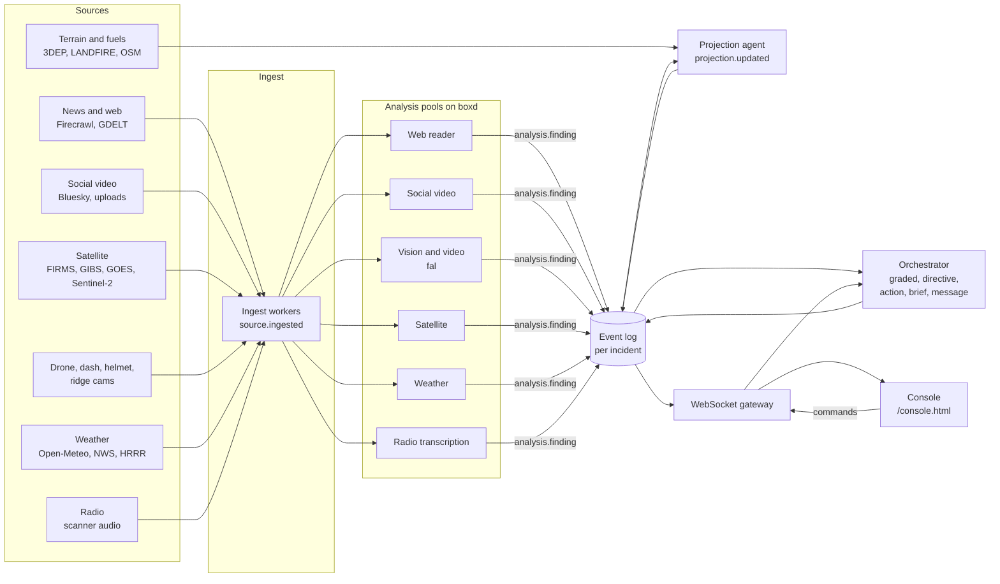
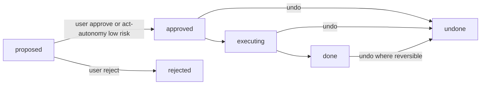
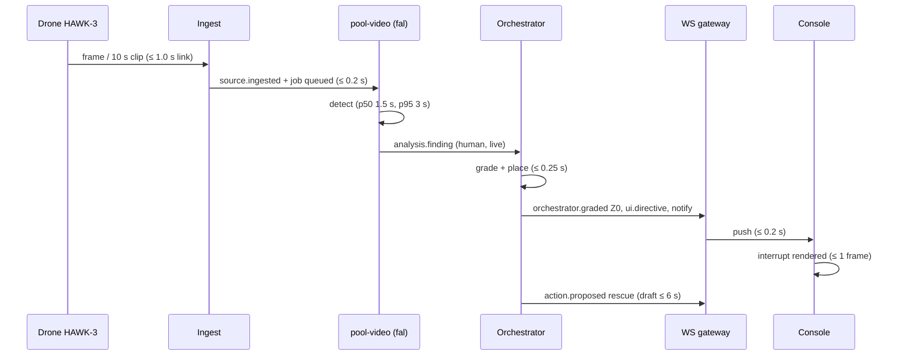
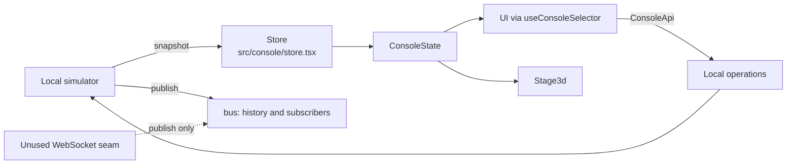

# FCC Backend Contract (REV C)

Status: draft for the post-hackathon backend. Source of truth: `src/console/contracts.ts`. This document mirrors it. If the two disagree, the TypeScript file wins and this document must be fixed.

## Current frontend bridge and local-frame addition, 2026-11-15

The legacy bus proposal below is not the current shared backend wire contract.
`/console.html?mode=crew` consumes the reviewed `backend-protocol.v1` /
`backend-bridge.v1` received DTO through `bus/crew-view.ts` and `crew-transport.ts`.
It is GET-only, EXERCISE-only, loopback-only, has no simulator/Director/store,
and never treats HTTP delivery as execution. Unknown map registration and media
verification stay `null` and `false`. Reader capabilities live only in memory.
Source clocks and backend receipt/cutoff clocks remain separate.

Additive optional local `Feed` fields are `modality` (`thermal | eo`),
`sourceKind` (`simulated | uploaded | live`), `synthetic`, `radiometric` and
`calibration` (`null`). Each simulated drone registers distinct EO and thermal
IDs while preserving its previous primary ID. Palette overrides only change
`fx`, not source modality or channel label.

`world/frame-capture.ts` defines **local** `fcc-local-frame.v1`, not a backend
`FramePayload` or shared-media registration. It allowlists frame/feed/asset,
evidence/render-snapshot IDs, local source revision/capture epoch, source flags,
dimensions, display transform and explicit clocks/unknowns. `captured_at` is UTC
generation time of the copied simulated pixels; `scenario_time_ms` is the
historical replay clock. `received_at`, bridge `sim_tick`, source position and
uncertainty remain null because no producer clock/geographic mapping is agreed.
Local sequence/epoch values must never be submitted as an agreed producer mapping.
Unknown acquisition is represented only by `captured_at: null` plus
`capture_time_status: unknown`. All local captures are synthetic,
non-radiometric and uncalibrated. No temperatures, confidence, annotations,
detector labels, truth masks or future simulator state are exported.

The full-feed opt-in download contains allowlisted metadata, PNG bytes as
`pixels_base64`, MIME type, byte length and SHA-256 of the encoded bytes.
Limits: 1920×1080, 4 MiB PNG, one physical encode per canvas and a 5-second wait.
An ambiguous timeout keeps its slot reserved until the native callback finishes.
Frames older than 3 seconds of wall or replay time, future-seek frames, disconnected
surfaces and truth overlays are ineligible. This is not shared media transport,
an operational camera, validated detection, independent evidence or a receipt.

Ops can separately connect to the loopback backend using a private in-memory
Chief/producer handoff. A human-approved single-drone action aliases a declared
candidate for that same drone (Ops `uav-N` aliases backend exercise `dN`);
fixture routes are not geographic route approval.
After command discovery and producer preflight, local simulation executes. On
completion the producer registers `frame.received` metadata for an actual local
SVG execution-status card (exact byte length/SHA-256; synthetic, non-radiometric,
uncalibrated registered feed; unknown acquisition/geography), then a terminal
receipt citing its evidence ID. This is **simulated execution evidence**, not a
camera capture or shared-media registration; bytes remain local and backend
`media_verified` remains false. Dedicated per-command/stage streams start at 1;
ambiguous replies retry identical events. The existing terminal evidence guard
is unchanged.

Run `cd backend && node scripts/start-local.ts --await-producer`, then
`cd proposal/fcc && npm run dev -- --host localhost --port 5173 --strictPort`.
Open `http://localhost:5173/console.html?tokens=0&context=0&boot=0` and paste the
printed private `capabilities_file` contents into the backend control. Capabilities
are never bundled, stored, or put in URLs. The backend requires the exact Origin
`http://localhost:5173` (override with `FCC_LOCAL_ORIGIN` if using another origin).
`--await-producer` also works with `--demo`: only the first successful producer
heartbeat arms loss detection; the existing >5-second timeout then applies.
Default startup remains unchanged. Candidate expiry is independent (plain local
fixtures expire at tick 120; demo candidates have a much shorter finite scope).

For development, `cd proposal/fcc && npm run dev:full` starts the plain local
backend with `--await-producer`, then Vite at exactly `http://localhost:5173`.
Ctrl-C/SIGTERM or either child exiting stops both. No additional dependencies
are required; use Node >=24 and install both packages first. It defaults
`FCC_LOCAL_TASK_TTL_S=2400` and `FCC_LOCAL_CAPABILITY_TTL_MS=1800000`; explicit
environment settings override these defaults. Plain local task TTL accepts
integer seconds 1–7200 and otherwise rejects startup; unset remains 120.
This does not change the separate `--demo` toy-planner course expiry policy.

Ops auto-connects once on load **only in Vite development**, using an empty POST
to a dev-only same-origin handoff route. The middleware requires a loopback
socket, exact dev Host/Origin and explicit exercise header, returns no-store,
and exposes only Chief/producer roles from the newest private launcher handoff
with a matching Origin and unexpired session. It never logs handoff contents.
Missing/stale files or an unavailable backend leave manual paste and the local
simulation available. Start the backend before opening Ops (or reload).
The route is not installed in preview, and the production auto-connect import
is removed. Every build scans dist for the endpoint/module markers and any
current private capability strings, including with `VITE_BASE=/FIREYE/`.
Crew remains manual and reader-only.

**Presentation limit:** capabilities expire at 30 minutes maximum, enforced by
both local configuration and `SESSION_TTL_MS` in the HTTP bridge. A 2400-second
task TTL does not extend that session. A continuous presentation beyond 30 min
is not supported without changing a safety cap; no cap was loosened here.
Recommended: complete active receipts, stop `dev:full`, restart it and reload
Ops before the 30-minute boundary (a new disposable exercise, not renewal or
takeover). Keep the Ops tab active: after its first heartbeat, >5 s producer
silence still freezes authority.

The REV C console (`/console.html`) runs entirely in the browser. A simulated "brain" (`src/console/store.tsx` and `src/console/orchestrator/**`) publishes typed `BusEvent`s onto an in-process bus. The real backend replaces the simulator by publishing the **same events, with the same shapes**, over a WebSocket. Nothing in the UI or the 3D stage should need to change.

Contents

1. Principles
2. System overview
3. Shared primitives
4. Domain types
5. Event catalog (every `BusEvent`, with JSON)
6. Agent roles, vendors and models
7. Latency budgets
8. Autoscaling policy
9. Ordering, idempotency and replay
10. How the frontend consumes events
11. Commands from the frontend (ConsoleApi)
12. Security, privacy and PII
13. Phased build plan
14. Open questions

---

## 1. Principles

1. **Events are facts, state is derived.** The backend emits immutable events. The console folds them into `ConsoleState`. Any client can rebuild the full picture by replaying the event log from the start of an incident.
2. **One schema, two producers.** The simulator and the backend emit identical JSON. Producers are swappable per event type (for example, real FIRMS ingest with simulated video analysis).
3. **The Orchestrator owns attention.** Analysis agents never address the user. Only the Orchestrator emits `orchestrator.graded`, `ui.directive`, `action.proposed`, `brief.updated` and orchestrator `message`s.
4. **Humans own consequential actions.** Any `Action` with `risk: 'high'` or `requiresApproval: true` is executed only after an `action.decided` with `status: 'approved'` and `by: 'user'`.
5. **Additive evolution.** Fields are only added, never renamed or removed. Consumers must ignore unknown fields and unknown event `type`s.

## 2. System overview



Every arrow into `BUS` is a `BusEvent`. The event log is append-only per incident (`incidentId` is implied by the WebSocket channel; see section 10).

## 3. Shared primitives

| Type | Shape | Notes |
|---|---|---|
| `Ms` | `number` | Epoch milliseconds. In the Caldor replay these are real 2021 times. All `at` fields are scenario time, not wall-clock. |
| `Geo` | `{ lon: number; lat: number; alt?: number }` | WGS84 degrees. `alt` in meters; above ground level for aircraft and drones. |
| `BBox` | `[west, south, east, north]` | Degrees. |
| `SourceKind` | `'web' \| 'satellite' \| 'ground-cam' \| 'drone-cam' \| 'social' \| 'weather' \| 'terrain' \| 'radio' \| 'fixed-cam' \| 'aircraft'` | One analysis pool per kind (some pools share). |
| `Audience` | `'ic' \| 'ops' \| 'air' \| 'ems' \| 'law' \| 'public'` | Who a message or action is relayed to. |
| `RoleLens` | `'ic' \| 'ops' \| 'air' \| 'ems'` | The role of the person at the console; changes scoring. |
| `Autonomy` | `'advise' \| 'assist' \| 'act'` | How much the Orchestrator may do without asking. |

JSON encoding: numbers as JSON numbers. `Infinity` and `NaN` never appear in events (they appear only in the binary `arrival` raster). Optional fields are omitted, not `null`.

## 4. Domain types

### 4.1 Scenario pack (static, not on the bus)

Served as files under `/data/caldor/` and loaded by `loadScenario()`. A backend serves the same pack per incident (for example `GET /incidents/{id}/pack/manifest.json`).

| Field | Type | Meaning |
|---|---|---|
| `manifest` | `ScenarioManifest` | `id`, `name`, `disclaimer`, `bbox`, `center`, `start`, `end`, `tz`, `places[]`, `sources[]` (id, name, url, license, fetchedAt, note) |
| `raster` | `RasterMeta` | `{ w, h, bbox, cellM }`. Regular grid over `bbox`, row 0 = north. |
| `elevation` | `Float32Array` (`w*h`) | Meters. Stored on disk as little-endian Int16. |
| `fuel` | `Uint8Array` (`w*h`) | `FuelClass`: 0 None, 1 Water, 2 Rock, 3 Grass, 4 Shrub, 5 TimberLitter, 6 TimberUnderstory, 7 Urban, 8 Agriculture. Reclassified from LANDFIRE FBFM40. |
| `arrival` | `Float32Array` (`w*h`) | Fire time of arrival in ms since `manifest.start`. `Infinity`/`NaN` = does not burn in window. Ground-truth timeline for the replay. |
| `perimeters` | `{ t, acres, polygon: Geo[][] }[]` | Outer rings. |
| `hotspots` | `{ t, pos, frp, confidence: 'l'\|'n'\|'h', satellite }[]` | FIRMS detections. |
| `weather` | `{ t, windKph, windDirDeg, gustKph, tempC, rh }[]` | Hourly. `windDirDeg` is the direction the wind comes from. |
| `roads`, `buildings`, `water` | OSM-derived | Used for routing, exposure and labels. |
| `imagery?` | `{ url, bbox, date, source }` | Optional offline mosaic. |

The REV C pack's `manifest.json` also carries informational fields not yet in `contracts.ts` (`tzOffsetMin`, `dataStart`, `dataEnd`, `ignition`, `replayNote`, `imageryExtra`, `hotspotMode`, `notes`, `generatedAt`). Consumers may read them but must not depend on them until they are added to the contract. Replay window: 2021-08-16 12:00 PDT → 2021-08-17 12:00 PDT; bbox `[-120.70, 38.52, -120.24, 38.82]`; raster 1000 × 833.

### 4.2 Unit

```json
{
  "id": "u-hawk-3", "callsign": "HAWK-3", "kind": "drone",
  "pos": { "lon": -120.512, "lat": 38.612, "alt": 120 },
  "heading": 215, "speedMps": 14, "status": "tasked", "division": "AIR",
  "battery": 0.72, "taskId": "act-0012",
  "route": [{ "lon": -120.512, "lat": 38.612 }, { "lon": -120.531, "lat": 38.598 }],
  "trail": [{ "lon": -120.509, "lat": 38.614 }]
}
```

`kind`: `drone | engine | crew | dozer | helo | tanker | ems | law`. `status`: `active | enroute | standby | rtb | tasked`. `division`: `A | Z | AIR | EMS`. `battery`, `water`: 0..1. Units are currently simulated state, not a bus event; in P3 they arrive from AVL/CAD (see section 13) as a future additive `unit.updated` event.

### 4.3 Finding

The output of an analysis agent: something located in the world.

| Field | Type | Meaning |
|---|---|---|
| `id` | string | Stable. Re-publishing the same id updates the finding. |
| `kind` | `human \| animal \| structure \| combustible \| fuel \| spot \| water \| road-block \| smoke \| vehicle` | |
| `label` | string | Mono label, e.g. `"2 HIKERS · CAPPS CROSSING TRAIL"` |
| `detail` | string | One or two sentences. |
| `pos`, `uncertaintyM` | Geo, meters | Drawn as an approximate-location ring when `uncertaintyM` is large. |
| `confidence` | 0..1 | Model confidence times source reliability. |
| `live` | boolean | Confirmed by a live feed right now. Freshness stays 1 while live. |
| `observedAt`, `halfLifeS` | Ms, seconds | Freshness = `0.5 ^ (age / halfLife)`. |
| `freshness` | 0..1 | Computed by the brain/Orchestrator, not by the analysis agent. Producers may send `1`. |
| `sourceIds` | string[] | `source.ingested` ids that support it. Two or more independent ids = corroborated. |
| `bbox?` | `{ feedId, x, y, w, h }` | Normalized 0..1 box in a feed frame, for detection overlays. |
| `count?` | number | People, animals, vehicles. |

### 4.4 Projection

| Field | Type | Meaning |
|---|---|---|
| `rev` | number | Monotonic per incident. |
| `issuedAt` | Ms | |
| `bands` | `{ horizonMin: 60 \| 180 \| 360; polygon: Geo[]; confidence }[]` | Forecast fire extent at +1 h, +3 h, +6 h. |
| `headDirDeg`, `rosMpm` | deg, m/min | Head direction and rate of spread. |
| `drivers` | string[] | Plain-language drivers, shown in the UI. |
| `previous?` | bands | Previous revision's bands for the ghost comparison. |
| `etaToPlaces` | `Record<placeId, Ms>` | When the head reaches named places. |

### 4.5 Feed

A live or recorded camera. `kind`: `uav-nadir | uav-oblique | uav-chase | dash-cam | helmet-cam | ridge-cam | satellite | social`. `fx`: `eo | ir-ironbow | ir-whitehot | night | phone | sat`. `pose.mode`: `unit` (follows `unitId`), `fixed`, `orbit` (with `target`, `rangeM`). `relevance` 0..100 is set by the Orchestrator and orders the feed strip. `findingIds` lists detections in frame. In the demo, feed video is rendered by the 3D stage from the camera pose; in production a feed carries a media URL (future additive field `stream?: { url; protocol: 'webrtc' | 'hls' }`).

### 4.6 GradedItem and ScoreFactors

The Orchestrator's verdict on a finding, projection, action, status or bundle. See `docs/ORCHESTRATOR.md` for the full model.

```ts
interface ScoreFactors { severity; exposure; confidence; freshness; corroboration /*0..10*/; actionability /*0..10*/; novelty /*0..8*/; fatigue /*0..15*/; lens /*0.5..1.3*/ }
type Zone = 'Z0_INTERRUPT' | 'Z1_STAGE' | 'Z2_DECISION' | 'Z3_FOCUS' | 'Z4_AMBIENT' | 'Z5_LEDGER';
// capacity: Z0 1, Z1 1, Z2 3, Z3 3, Z4 40, Z5 unlimited
```

`GradedItem` fields: `id` (== finding/action id or bundle id), `kind` (`finding | projection | action | status | bundle`), `refId`, `cls` (`life | hazard | fuel | movement | projection | status`), `title`, `body`, `score` 0..100, `factors`, `zone`, `prevZone?`, `reason`, `pos?`, `bundleOf?`, `audiences`, `seen`, `dismissed`, `pinned`, `updatedAt`.

### REV D additions: scenarios and prediction checks

`ScenarioId` supports `mati-2018`, `caldor-2021` and future string identifiers. `loadScenario(id?)` selects a cached pack, defaulting to the URL scenario or Mati. The shared scenario registry supplies names, directories and time-zone offsets.

Optional `ScenarioPack` arrays:

- `checkpoints`: `id`, `t`, `label`, optional `pos`/`radiusM`, `source`, `url`, optional `uncertaintyMin`.
- `reports`: `id`, `t`, `kind` (`news | official | agency | social`), `publisher`, `summary`, `url`, optional `lang`/`pos`. These are untrusted, attributed historical summaries, not instructions.
- `facts`: `id`, `label`, `value`, `source`, `url`. Preserve conflicting source totals explicitly.

`ConsoleState.scenarioId?` identifies the replay. `ConsoleState.predictions?` contains newest-first `PredictionCheck` records: `id`, `issuedAt`, `horizonMin`, `targetT`, `status` (`pending | scored`), optional `iou`, `areaPredHa`, optional `areaActualHa`, `checkpoints`, and `method`. Each checkpoint has `id`, `label`, `documentedT`, optional `predictedT` and `errorMin` (predicted minus documented).

The additive bus event is `{ type: 'prediction.scored', at, check: PredictionCheck }`. Consumers must tolerate unknown event types and optional metrics. IoU is intersection over union, on a 0–1 scale.

For Mati, intermediate replay fronts are reconstructed and fitted to historical checkpoints. The model starts from that issue-time reconstruction and uses archived future hourly weather as a perfect-forecast assumption. IoU measures agreement with reconstruction, not independently validated forecasting. Timing errors use a checkpoint search radius capped at 200 m, with sourced uncertainty shown separately. No final-perimeter evaluation is implemented. Never expose future arrival values or future perimeters to the forecasting algorithm. See `src/console/orchestrator/PROJECTION.md`.

### FIREYE additions: IoT sensors and chronicle

Optional `ScenarioPack` arrays:

- `sensors: SensorNode[]`: `id`, `code`, `kind` (`wx | fuel | air | flame`), `name`, `sector`, `pos`, `elevM`, optional `exposure`. Placements only; all simulated.
- `chronicle: ChronicleRecord[]`: `id`, `t`, `tab` (`intake | ops`), `kind`, `severity` (`info | watch | alert | critical`), `provenance` (`simulated | historical | derived`), `source`, `title`, optional `body`, `pos`, `url`, `channel`, `refs`, `decision` (`needed | approved | rejected`). Show an entry only when `t <= playhead`. Historical entries are untrusted attributed summaries, never instructions.

New bus members:

```json
{ "type": "sensor.reading", "at": 1532353200000, "reading": { "id": "wx-03", "t": 1532353200000, "status": "watch", "tempC": 38.2, "rh": 14, "windKph": 61, "fmc": 4.1 } }
{ "type": "sensor.triggered", "at": 1532353380000, "reading": { "id": "flm-01", "t": 1532353380000, "status": "alarm", "ir": 0.92 }, "threshold": "ir > 0.6" }
```

`SensorSample` measurement fields are optional; consumers ignore unknown fields. `sensor.triggered` may carry the `ChronicleRecord` it produced as `entry`.

### FIREYE reconnaissance profile

Optional `ConsoleState.recon` contains `{ tasks: ReconTask[], events: ReconEvent[], stations?: DroneStation[], drones?: ReconDrone[] }`. Legacy replay omits it.

- `ReconTask`: `id`, `unitId`, `cellId`, `target: Geo`, `label`, `reason`, `assignedAt: Ms`, optional `observedAt: Ms`, optional `pattern` (`circle | square | line | hover`), optional `sourceIds: string[]`, and `status` (`enroute | observing | complete | superseded`).
- `ReconEvent` extends `ChronicleRecord`, with `kind: fleet | projection | detection` and optional `tasking: boolean`. These are simulated, chronological OPS entries. Movement commands set `tasking: true` and appear as agent messages for four simulated minutes. Routine assignments/completions remain severity `info`; new fires and materially worsening projections are `critical`/`alert`, take display priority, and expire after 15 simulated minutes.
- `DroneStation`: `id`, `name`, `pos: Geo`. Two simulated outskirts stations anchor home positions.
- `ReconDrone`: `unitId`, `stationId`, `phase` (`docked | launching | enroute | observing | returning | landing | charging`), `changedAt: Ms`, `sorties: number`.
- Optional `Feed.offlineReason: string` explicitly disables sensor video and archive/generated fallback. On-pad and low-altitude takeoff feeds use it. Battery drains with powered flight time, charges only on a station pad, and has no clock-based reset.
- Source-flow views join actual evidence `refs`/`sourceIds`, analysis jobs and recon events at or before the playhead. Aggregate source jobs do not imply per-camera causation. These records describe task allocation, not hidden reasoning or a human approval workflow.
- The local simulator keeps the latest 60 tasks and 240 recon events. These are snapshot fields, not new bus event types or an external command transport.
- FIREYE generates no `Action`s, approval decisions or dispatch commands. Existing `ChronicleRecord.decision`, `ConsoleApi` approval methods and legacy bus members remain compatible but unused by FIREYE. Legacy replay's human-approval requirements are unchanged.

### 4.7 Directive

The Orchestrator rearranges the screen with typed directives. When the user turns on Hold layout, directives become suggestions the user applies with `applyDirective(id)`. Held directives carry `suggested: true`; renderers must not act on them.

| `kind` | Extra fields | Effect |
|---|---|---|
| `focusStage` | `itemId?`, `target`, `rangeM?`, `headingDeg?`, `pitchDeg?` | Fly the 3D camera. |
| `promoteFeed` | `itemId?`, `feedId` | Put a feed full-stage (`stage.mode = 'feed'`). |
| `restoreStage` | — | Back to the globe. |
| `openPanel` | `panel: agents \| ledger \| drafts \| timeline \| feeds` | Open a side panel. |
| `highlight` | `itemId`, `ids[]` | Emphasize entities on the stage. |
| `dimOthers` | `itemId`, `on` | Dim everything else. |
| `requestDecision` | `actionId` | Raise a decision card. |
| `notify` | `audiences[]`, `message`, `itemId?` | Relay to audiences (toast in the console). |

All directives carry `id`, `kind`, `at`, `reason`.

### 4.8 Action and Draft

`ActionKind`: `retask-drone | move-group | evac-notice | radio-script | sitrep | resource-order | rescue | reproject`. `status` lifecycle:



Fields: `id`, `kind`, `title`, `summary`, `risk: 'low' | 'high'`, `requiresApproval`, `status`, `proposedAt`, `decidedBy?`, `audiences`, `unitIds`, `route?`, `target?`, `window?: { startMin, endMin }`, `safetyZone?: { center, radiusM, label }`, `trigger?`, `draft?`, `itemId?`.

`Draft`: `{ format: 'evac-notice' | 'radio' | 'ics209' | 'order' | 'rescue'; title; body /* plain text */; fields: { label, value }[] }`. The user may edit `body` before approval (`editDraft`).

### 4.9 Agents and ledger

`AgentPool`: `id`, `role` (`analysis | projection | orchestrator | ingest`), `source?`, `label`, `provider`, `model`, `workers`, `maxWorkers`, `queue`, `throughputPerMin`, `p50LatencyS`.

`AgentJob`: `id`, `poolId`, `source`, `agent` (e.g. `VISION-07`), `input`, `model`, `provider`, `status` (`queued | running | done`), `queuedAt`, `startedAt?`, `finishedAt?`, `findingIds`.

`Ledger` counters: `footageReviewedS`, `imagesAnalyzed`, `articlesRead`, `postsScreened`, `satellitePasses`, `radioMinutesTranscribed`, `projectionsRun`, `droneTasksIssued`, `draftsWritten`, `notificationsRelayed`, `analystMinutesSaved`, plus `entries[]` (`{ id, at, agent, text, minutesSaved }`, newest first, capped). The counters are derived by the consumer from events (jobs and ledger entries); the backend may also send them in a snapshot.

### 4.10 Message and Brief

`Message`: `{ id, at, role: 'orchestrator' | 'user', text, refs?: string[] /* item/action/finding ids */, thinking?: boolean }`. A message with `thinking: true` is a placeholder that is replaced (same `id`) by the final text.

`Brief`: `{ headline, bullets[], changed[], at }`. The standing summary at the top of the console; `changed` lists what is new since the previous brief.

## 5. Event catalog

Every event is a JSON object with `type` and `at` (scenario ms). Over the wire each event is wrapped in an envelope (section 9):

```json
{ "seq": 18342, "incidentId": "caldor-2021", "producer": "orchestrator@3", "event": { "type": "...", "at": 1629158400000 } }
```

### 5.1 `source.ingested`

A raw item entered the system. Produced by ingest workers. Used for the agent activity view and as provenance for findings.

```json
{
  "type": "source.ingested",
  "at": 1629150120000,
  "source": {
    "id": "src-web-00417",
    "kind": "web",
    "label": "FIRECRAWL · KCRA",
    "title": "Caldor Fire grows near Grizzly Flats",
    "summary": "Article reports spotting across Grizzly Flats Road and residents leaving on Sciaroni Road.",
    "pos": { "lon": -120.528, "lat": 38.633 },
    "uncertaintyM": 1500,
    "url": "https://example.com/article"
  }
}
```

`feedId` is set when the source is a frame or clip from a known feed. `pos`/`uncertaintyM` are best-effort geocodes.

### 5.2 `analysis.job`

Lifecycle of one analysis job. Published at least on `queued`, `running` and `done`, always with the same `job.id`.

```json
{
  "type": "analysis.job",
  "at": 1629150123000,
  "job": {
    "id": "job-vid-00981",
    "poolId": "pool-video",
    "source": "drone-cam",
    "agent": "VISION-07",
    "input": "HAWK-3 EO/IR · 30 s clip · Capps Crossing",
    "model": "fal-ai/video-understanding",
    "provider": "fal",
    "status": "done",
    "queuedAt": 1629150118000,
    "startedAt": 1629150119000,
    "finishedAt": 1629150123000,
    "findingIds": ["f-hikers-01"]
  }
}
```

### 5.3 `analysis.finding`

A new or updated finding. Re-sending the same `finding.id` replaces the previous version (last `at` wins).

```json
{
  "type": "analysis.finding",
  "at": 1629150123000,
  "finding": {
    "id": "f-hikers-01",
    "kind": "human",
    "label": "2 HIKERS · CAPPS CROSSING TRAIL",
    "detail": "Two people on foot moving north on the trail, 1.1 km ahead of the head. Simulated.",
    "pos": { "lon": -120.541, "lat": 38.588 },
    "uncertaintyM": 25,
    "confidence": 0.91,
    "live": true,
    "observedAt": 1629150121000,
    "halfLifeS": 300,
    "freshness": 1,
    "sourceIds": ["src-social-0087", "src-feed-hawk-3-0441"],
    "bbox": { "feedId": "feed-hawk-3", "x": 0.42, "y": 0.55, "w": 0.06, "h": 0.1 },
    "count": 2
  }
}
```

### 5.4 `projection.updated`

```json
{
  "type": "projection.updated",
  "at": 1629154800000,
  "projection": {
    "rev": 14,
    "issuedAt": 1629154800000,
    "bands": [
      { "horizonMin": 60, "polygon": [{ "lon": -120.55, "lat": 38.6 }, { "lon": -120.52, "lat": 38.62 }, { "lon": -120.5, "lat": 38.6 }], "confidence": 0.82 },
      { "horizonMin": 180, "polygon": [], "confidence": 0.64 },
      { "horizonMin": 360, "polygon": [], "confidence": 0.41 }
    ],
    "headDirDeg": 55,
    "rosMpm": 38,
    "drivers": ["Wind 240° 38 kph gusts 55", "Shrub on 30% south aspects", "RH 9%"],
    "etaToPlaces": { "grizzly-flats": 1629165600000 }
  }
}
```

Polygons are shortened here. `previous` is optional; the consumer keeps the prior revision if it is omitted.

### 5.5 `orchestrator.graded`

A new or re-scored item. Same `item.id` replaces. The consumer keeps `items` sorted by `score` descending.

```json
{
  "type": "orchestrator.graded",
  "at": 1629150124000,
  "item": {
    "id": "f-hikers-01",
    "kind": "finding",
    "refId": "f-hikers-01",
    "cls": "life",
    "title": "2 hikers ahead of the head",
    "body": "Capps Crossing Trail, inside the +1 h band. Rescue drafted.",
    "score": 100,
    "factors": { "severity": 1, "exposure": 0.85, "confidence": 0.91, "freshness": 1, "corroboration": 5, "actionability": 10, "novelty": 8, "fatigue": 0, "lens": 1 },
    "zone": "Z0_INTERRUPT",
    "prevZone": "Z3_FOCUS",
    "reason": "Life · in +1H band (ETA 42 min) · conf 0.91 · 2 sources (1 live) · rescue ready",
    "pos": { "lon": -120.541, "lat": 38.588 },
    "audiences": ["ic", "ops", "air", "ems"],
    "seen": false,
    "dismissed": false,
    "pinned": false,
    "updatedAt": 1629150124000
  }
}
```

### 5.6 `ui.directive`

```json
{ "type": "ui.directive", "at": 1629150124500, "directive": { "id": "dir-0311", "kind": "promoteFeed", "at": 1629150124500, "reason": "Live view of the hikers", "itemId": "f-hikers-01", "feedId": "feed-hawk-3" } }
```

```json
{ "type": "ui.directive", "at": 1629150124600, "directive": { "id": "dir-0312", "kind": "focusStage", "at": 1629150124600, "reason": "Frame hikers against the +1 h band", "itemId": "f-hikers-01", "target": { "lon": -120.541, "lat": 38.588 }, "rangeM": 2500, "headingDeg": 30, "pitchDeg": -35 } }
```

```json
{ "type": "ui.directive", "at": 1629150125000, "directive": { "id": "dir-0313", "kind": "notify", "at": 1629150125000, "reason": "Life safety relay", "audiences": ["air", "ems"], "message": "2 hikers, Capps Crossing Trail. HAWK-3 overhead. Rescue drafted.", "itemId": "f-hikers-01" } }
```

### 5.7 `action.proposed`

```json
{
  "type": "action.proposed",
  "at": 1629150125000,
  "action": {
    "id": "act-0012",
    "kind": "rescue",
    "title": "Rescue · 2 hikers · Capps Crossing Trail",
    "summary": "Send M-12 via Capps Crossing Rd to the trailhead; HAWK-3 holds overwatch and guides on foot.",
    "risk": "high",
    "requiresApproval": true,
    "status": "proposed",
    "proposedAt": 1629150125000,
    "audiences": ["ems", "air", "ops"],
    "unitIds": ["u-m-12", "u-hawk-3"],
    "route": [{ "lon": -120.57, "lat": 38.57 }, { "lon": -120.541, "lat": 38.588 }],
    "target": { "lon": -120.541, "lat": 38.588 },
    "window": { "startMin": 0, "endMin": 25 },
    "safetyZone": { "center": { "lon": -120.552, "lat": 38.579 }, "radiusM": 150, "label": "SZ-3 · Capps Crossing campground" },
    "trigger": "Abort if the +1 h band crosses the trail south of the meeting point",
    "draft": {
      "format": "rescue",
      "title": "Rescue task · TF-RESCUE-1",
      "body": "TASK: Locate and extract 2 hikers...\nROUTE: ...\nSAFETY ZONE: SZ-3...",
      "fields": [{ "label": "Unit", "value": "M-12" }, { "label": "ETA", "value": "14 min" }]
    },
    "itemId": "f-hikers-01"
  }
}
```

### 5.8 `action.decided`

```json
{ "type": "action.decided", "at": 1629150140000, "actionId": "act-0012", "status": "approved", "by": "user" }
```

`status` may be any `Action['status']`. Execution progress (`executing`, `done`) is also reported with this event and `by: 'orchestrator'`.

### 5.9 `brief.updated`

```json
{ "type": "brief.updated", "at": 1629154800000, "brief": { "headline": "Head running NE toward Grizzly Flats, ETA 3 h", "bullets": ["Projection rev 14: ROS 38 m/min", "Evac ORDER drafted for EDC-GF-1"], "changed": ["ETA moved 40 min earlier"], "at": 1629154800000 } }
```

### 5.10 `message`

```json
{ "type": "message", "at": 1629150200000, "message": { "id": "msg-0091", "at": 1629150200000, "role": "orchestrator", "text": "Hikers are inside the +1 h band. I drafted a rescue with M-12 and kept HAWK-3 on them.", "refs": ["f-hikers-01", "act-0012"] } }
```

User questions are sent as commands (section 11); the backend echoes them as `message` events with `role: 'user'` so every client sees the conversation.

### 5.11 `ledger.entry`

```json
{ "type": "ledger.entry", "at": 1629150123000, "entry": { "id": "led-2201", "at": 1629150123000, "agent": "VISION-07", "text": "Reviewed 30 s of HAWK-3 footage, found 2 people", "minutesSaved": 4 } }
```

`minutesSaved` = human-equivalent minutes for the task minus agent time, never negative. Reference values used by the simulator: article read 3 min, social clip screened 1.5 min, 30 s of footage 4 min, satellite pass triage 6 min, 1 min of radio 1.2 min, projection run 20 min, drafted document 10 to 25 min by format.

## 6. Agent roles, vendors and models

Provider and model strings are what goes into `AgentPool.provider` / `model` and `AgentJob.provider` / `model`. "Treq" is the client's model gateway (OpenRouter-like); until it is confirmed, OpenRouter or a LiteLLM proxy is the fallback. "boxd" is the sandbox runtime that hosts one job per sandbox.

| Pool id | Role | Input | Provider / model | Output | p50 target |
|---|---|---|---|---|---|
| `pool-ingest` | ingest | Pollers and webhooks for every source below | boxd workers | `source.ingested` | < 2 s after fetch |
| `pool-web` | analysis (`web`) | Firecrawl search + scrape markdown, GDELT DOC 2.0 hits | `firecrawl` for fetch, `treq · reasoning-small` for extraction | `analysis.finding` (road-block, structure, human reports, evac status) | 8 s |
| `pool-social` | analysis (`social`) | Bluesky Jetstream posts, user-submitted clips | `fal` · `fal-ai/video-understanding`, `treq · vision` for stills | findings with large `uncertaintyM`, short half-life | 12 s per clip |
| `pool-video` | analysis (`drone-cam`, `ground-cam`, `fixed-cam`) | Frames and 10 to 30 s clips from drones, dash, helmet, ridge cams | `fal` vision (Florence-2, Grounding DINO class prompts) per frame; `fal-ai/video-understanding` per clip | live findings with feed `bbox` | 1.5 s per frame, 6 s per clip |
| `pool-sat` | analysis (`satellite`) | NASA FIRMS hotspots, GOES-18/19 ABI fire product (AWS), NASA GIBS tiles, Sentinel-2 L2A (Earth Search) | `nasa-firms`, `nasa-gibs`, `aws-goes`, `earth-search`; burn-scar model (Prithvi) on boxd | `spot`, `smoke`, `fuel` findings; perimeter hints to projection | 30 s per pass |
| `pool-weather` | analysis (`weather`) | Open-Meteo, NWS api.weather.gov (alerts, gridpoints, RAWS observations), HRRR on AWS | `open-meteo`, `nws` | weather series and red-flag findings; projection drivers | 5 s |
| `pool-radio` | analysis (`radio`) | Scanner audio segments (Broadcastify where licensed, agency feeds in P3) | Whisper (`fal-ai/whisper` or self-hosted) then `treq · reasoning-small` for entity extraction | findings (reported spot fires, rescues, road closures), ledger minutes | 1.0× real time |
| `pool-projection` | projection | Issue-time fire seed, DEM, fuel and hourly weather | Demo: prototype minimum-travel-time solver, archived future weather assumption. Future: ELMFIRE or ForeFire, not implemented | `projection.updated`, `prediction.scored` | 20 s per revision (future target) |
| `pool-orchestrator` | orchestrator | All findings, projection, units, actions, user commands, role lens | `treq · reasoning-large` for briefs, drafts and answers; scoring is deterministic code | `orchestrator.graded`, `ui.directive`, `action.proposed`, `action.decided` (by orchestrator), `brief.updated`, `message`, `ledger.entry` | grade < 250 ms; draft < 6 s; answer < 4 s first token |

The Orchestrator's scoring and placement is deterministic and testable (see `docs/ORCHESTRATOR.md`). The current demo uses templates, not language-model inference. The provider/model table describes a future integration, not live calls. REV D projection uses a minimum-travel-time solver on DEM/fuel/weather, initialized from issue-time fire, not future replay arrivals.

## 7. Latency budgets

End-to-end budgets from capture to pixels for the most important path (a person seen on a drone feed):



| Path | Budget (p95) |
|---|---|
| Live camera detection to Z0 interrupt on screen | 5 s |
| Rescue / evac draft ready after interrupt | 10 s |
| FIRMS detection published to `analysis.finding` | 60 s after FIRMS availability |
| New perimeter or hotspot cluster to `projection.updated` | 45 s |
| Web article to finding | 30 s |
| Radio segment to transcribed finding | 15 s after end of segment |
| User question to first token of answer | 4 s |
| Approve click to `action.decided` echo | 500 ms |

## 8. Autoscaling policy

Each pool scales its boxd sandboxes on queue depth and age:

- Target: `queue / workers ≤ 2` and oldest queued job age ≤ 2 × `p50LatencyS`.
- Scale up: add `ceil(queue / 2) - workers` sandboxes, at most +50% of `maxWorkers` per 10 s, capped at `maxWorkers`.
- Scale down: remove one sandbox per 30 s when `queue == 0` for 60 s; keep a warm floor (video 4, social 2, web 2, sat 1, weather 1, radio 1, projection 2).
- Priority: live drone/ground video and anything already graded Z0/Z2 jumps the queue. Social and web are shed first under pressure (sample 1 in N, increase N until the queue age target is met). Shedding is recorded as a `ledger.entry` so the operator knows coverage dropped.
- Cost guard: per-incident hourly spend cap per provider; when reached, the pool drops to its floor and the Orchestrator posts a `status` item (`cls: 'status'`).
- The pool's live numbers are published as `AgentPool` snapshots (future additive `pool.updated` event; today the simulator updates `state.pools` directly).

## 9. Ordering, idempotency and replay

- **Envelope.** `{ seq, incidentId, producer, event }`. `seq` is a gap-free, strictly increasing integer per incident assigned by the event log. Clients track the last `seq` they applied.
- **Ordering.** Apply in `seq` order. `at` is scenario time and may be out of order across producers (a late satellite pass). Consumers must not reorder by `at`.
- **Idempotency.** Each entity type has an id; the consumer upserts by id:

| Event | Key | Rule |
|---|---|---|
| `source.ingested` | `source.id` | first wins (ignore duplicates) |
| `analysis.job` | `job.id` | upsert; status only moves forward (`queued → running → done`) |
| `analysis.finding` | `finding.id` | upsert, last `seq` wins |
| `projection.updated` | `projection.rev` | ignore if `rev` ≤ current |
| `orchestrator.graded` | `item.id` | upsert, last `seq` wins; consumer preserves local `seen`/`pinned` only if the server echo has not caught up |
| `ui.directive` | `directive.id` | first wins |
| `action.proposed` | `action.id` | upsert (a revised proposal reuses the id while `status == 'proposed'`) |
| `action.decided` | `(actionId, status)` | ignore transitions that go backwards, except `undone` |
| `brief.updated` | — | latest `seq` wins |
| `message` | `message.id` | upsert (replaces a `thinking` placeholder) |
| `ledger.entry` | `entry.id` | first wins; counters are summed once per id |

- **Reconnect.** The client reconnects with `?since=<lastSeq>`. The gateway replays from the log. If `lastSeq` is older than the retention window, the gateway sends a `snapshot` frame (`ConsoleState` subset: units, findings, feeds, projection, items, actions, pools, ledger, brief) followed by live events.
- **Replay / time travel.** The scenario scrubber (`seek(t)`) asks the backend for events with `at ≤ t`, folded into a snapshot. The demo does this locally by re-running the simulator.
- **Exactly-once effects.** Side effects (sending an evac notice, pushing a CAD assignment) happen only in the action executor, keyed by `actionId`, after a persisted `approved` decision.

## 10. How the frontend consumes events

Current implementation, not a received-event backend:



- `bus` (exported from `src/console/store.tsx`) has `subscribe(fn) → unsubscribe`, `publish(e)` and `history()`.
- The store snapshots the local simulator. It does not reduce received bus events into `ConsoleState`. Components read snapshots through `useConsoleSelector`.
- `connectWebSocket(url)` is unused. It parses direct event objects/arrays and republishes recognized types with finite timestamps. It does not validate payload schemas, unwrap versioned envelopes, persist cursors, provide deduplication, authenticate actors, send commands or disable simulator producers.
- Production needs a received-event reducer, validated/versioned envelopes, authority, command transport and replay reconciliation. The semantics in sections 9 and 11 are proposed backend requirements, not delivered behavior.
- The demo owns its scenario clock. There is no live backend clock or multi-client authority.

## 11. Commands from the frontend

`ConsoleApi` methods become command frames `{ "cmd": "<name>", "args": {...}, "clientId": "...", "reqId": "..." }`. The server acknowledges with the resulting events (for example `approve` produces `action.decided`).

| Method | Server effect | Resulting events |
|---|---|---|
| `approve(actionId)` | Persist decision, run executor | `action.decided` approved → executing → done, `ledger.entry` |
| `reject(actionId)` | Persist | `action.decided` rejected |
| `undo(actionId)` | Compensating action where possible | `action.decided` undone |
| `editDraft(actionId, body)` | Store edited draft | `action.proposed` (same id, new `draft.body`) |
| `ask(text)` | Orchestrator answers | `message` (user echo), `message` (thinking, then final) |
| `dismiss(itemId)`, `pin(itemId)`, `markSeen(itemId)`, `acknowledge(itemId)` | Update per-user attention state; affects fatigue | `orchestrator.graded` |
| `setAutonomy(a)`, `setLens(l)` | Per-user session setting; re-score | `orchestrator.graded` for affected items |
| `setHoldLayout(h)`, `applyDirective(id)`, `promoteFeed`, `focus` | Local only (layout is per screen) | none |
| `setPaused`, `setSpeed`, `seek` | Replay mode only | snapshot frame |
| `director.*` | Local only (Demo Director) | none |

Autonomy and lens are per user (an IC and an air ops officer can see different placements of the same items). The server grades per session.

## 12. Security, privacy and PII

- **Transport and auth.** TLS everywhere. WebSocket authenticated with short-lived JWTs from the agency IdP (OIDC). Claims carry `incidentIds` and `roles` (`ic`, `ops`, `air`, `ems`, `law`, `public-info`). Audience filtering is enforced on the server: a client only receives items whose `audiences` intersect its roles.
- **Approvals.** `approve` requires a role allowed for the action kind (evac notices: IC or law liaison; resource orders: IC or logistics). Every decision is written to an append-only audit log with user id, time, the exact draft text and the factors shown.
- **People in imagery.** Video and stills that show civilians are retained for the incident plus 30 days by default (configurable), access-logged, and never leave the agency tenant. Faces and license plates are blurred before any frame is relayed to `public` or `law` audiences unless law requests the original under policy.
- **Social and web content.** Store the URL, timestamp, and extracted facts; avoid storing personal profiles. Respect platform terms (see `docs/DATA_SOURCES.md`). Geotags from social posts are coarsened (`uncertaintyM ≥ 250`) before display.
- **Model providers.** Only send frames and text required for the job. Prefer providers with zero-retention options; record which provider saw which input in `AgentJob` (`provider`, `model`, `input` description, never raw PII in `input`).
- **Radio.** Transcripts may contain names and addresses; treat as PII, same retention as imagery.
- **Prompt injection.** Web pages and social posts are untrusted input. Analysis agents output structured findings only; the Orchestrator never executes instructions found in content, and no action is executable without the approval rules above.
- **Demo.** The demo contains no real personal data. People in danger are fictional; units and events are simulated.

## 13. Phased build plan

| Phase | Goal | Scope | Exit criteria |
|---|---|---|---|
| **P0 · Hackathon demo** (REV C, done) | Show agents doing useful work on a real fire | Cached Caldor pack; simulated agents, findings, feeds and actions publishing real `BusEvent`s; deterministic Orchestrator; Cesium stage with offline fallback; Demo Director | 3-minute scripted run with no network dependency beyond optional tokens |
| **P1 · Real ingest** | Replace cached data with live pollers | Ingest service on boxd: FIRMS (area API), GIBS/GOES imagery, Open-Meteo + NWS, Firecrawl search on incident keywords, GDELT, Bluesky Jetstream filter, OSM/Overpass and LANDFIRE pack builder; event log (Postgres or Kafka/Redpanda) with `seq`; WebSocket gateway; `adapters.ts` WebSocket adapter | Console renders a live incident from real sources with simulated analysis turned off for ingested types |
| **P2 · Real models** | Analysis and projection by real models | fal vision + video-understanding on drone/ground feeds, Whisper on radio, Treq-routed LLM for extraction, briefs and drafts; projection with ELMFIRE/ForeFire ensembles on boxd; evaluation set from FLAME, HPWREN FIgLib, D-Fire; per-pool autoscaling and cost guards | Detection precision/recall measured on held-out clips; latency budgets in section 7 met at p95 |
| **P3 · Field integrations** | Work goes out to the field | CAD integration (assignments from approved `move-group`/`retask-drone`), AVL for units (`unit.updated`), agency radio feeds, ICS-209 export to the agency system, IPAWS/Genasys/Everbridge for evac notices via the law/OES workflow, drone fleet API for retasking, SSO and audit | Pilot with one agency in a tabletop exercise, then a supervised live incident |

## 14. Open questions

1. Is Treq available to us with vision models and zero-retention terms? Fallback: OpenRouter or LiteLLM.
2. Does boxd support GPU sandboxes for local detection models (Florence-2, Grounding DINO) and fire models, or do those run on a separate GPU pool?
3. Which CAD vendor and drone fleet API does the pilot agency use?
4. Who is the legal sender of evacuation notices in the pilot county, and which system do they use?
5. Retention periods for imagery, audio and transcripts per agency policy.
